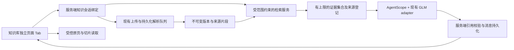

# 知识库页面与有来源的模型问答：案例核查及接入建议

核查日期：2026-11-13。交付性质：方案研究，供独立页面 Tab 的前端预览和后续实现评审使用。本文没有修改产品代码、迁移数据库、重启服务、上传 PDF、下载模型权重或调用模型。下文“现有”来自本地源码，“案例事实”来自项目官方源码/文档，“建议”均为待实现和待验收的设计。

建议在现有 GREAT_Agent 内扩展：保留 SQLite 的文档身份、版本和原页定位，增加独立知识会话、受绑定范围约束的只读检索，以及由服务端持久化的引用块。AgentScope 2.0.11 和现有 GLM-4.7 接入继续负责生成；embedding、reranker 是独立组件，不能把聊天模型已接通等同于向量检索已完成。

## 1. 本地基线：能直接复用什么

依据 [入库设计](../superpowers/specs/2026-11-12-knowledge-ingestion-design.md)，并核对当前以下实现：

| 当前实现 | 可直接扩展 | 尚缺的部分 |
| --- | --- | --- |
| [knowledge_models.py](../../backend/src/great_agent/db/knowledge_models.py)：8 张知识表；blob hash、不可变 version、page/element/chunk、原生结构 JSON、quality flags | 文档列表、解析状态、版本、来源身份、片段和页坐标 | embedding/index 生命周期、会话绑定、逐轮检索记录 |
| [knowledge_repository.py](../../backend/src/great_agent/db/knowledge_repository.py)：`search(base_id, query, document_ids, limit)`、`get_chunk`、`list_chunks` | FTS5 词法基线；搜索只取 enabled、active version、已发布状态；参数绑定和 FTS 转义 | dense、融合、rerank、跨轮引用契约；`get_chunk` 本身没有知识会话范围检查 |
| [knowledge_schema.py](../../backend/src/great_agent/db/knowledge_schema.py)：外部内容 FTS5、unicode61 tokenizer、触发器、schema guard | 同事务发布和词法索引；隔离 DB 验证 | 中文分词索引需要显式迁移，不能直接改现有 FTS DDL 绕过 guard |
| [conversation_agent.py](../../backend/src/great_agent/runtime/conversation_agent.py)：AgentScope 原生 Agent/Toolkit、物理请求计数、tool/时间预算、取消、安全响应边界 | 模型 transport、超时/预算、无隐式总结调用、只读 FunctionTool 注册方式 | `get_capabilities` 仍返回 `knowledge_search: false`、`paper_analysis_ready: false`；没有检索工具 |
| [conversation_service.py](../../backend/src/great_agent/services/conversation_service.py)：持久化对话/run、幂等 request、owner 保护、结构化 blocks | 请求/响应及引用块的耐久保存；错误/取消恢复 | 当前 `context is None` 代表全局聊天，会启用实验创建；不能直接作为知识聊天的权限判断 |
| [conversation_models.py](../../backend/src/great_agent/db/conversation_models.py)：`scope` 唯一、`String(64)`；当前只有 global 或 experiment id | 独立 conversation/run/message 表 | 显式 knowledge scope 和库/文档过滤；目前按库或选中文档自动形成独立会话的功能不存在 |
| [config.py](../../backend/src/great_agent/config.py)、[agentscope_model.py](../../backend/src/great_agent/adapters/agentscope_model.py) | `SecretStr`、`GREAT_AGENT_MODEL_API_KEY`、现有 OpenAI 兼容 transport、日志脱敏策略 | 检索组件配置、片段外发策略和相关诊断；当前知识配置仅包含入库/解析选项 |

本地 `pyproject.toml` 和 `uv.lock` 固定 `agentscope==2.0.11`。这不是要求升级 SDK 的任务。当前运行时将 GLM 的 thinking 设为 disabled、`stream=False`、禁用重试；知识回答第一版应沿用这些已存在的边界。本文没有实测 GLM-4.7 的新引用输出或 tool round trip。

## 2. 三个可检查的实际案例

这些案例提供公开代码或带输出的官方工作流，足以核查链路怎样连接；本轮没有本地启动它们，因此不宣称在本机复现成功。链接指向核查日的官方文档和 `main` 分支，分支会变化；不以 star、第三方介绍或未经核对的“最新版本号”证明能力。正式借用依赖或代码时再锁定 commit/包版本与许可证。

### 2.1 Docling：结构化解析和可追溯的 chunk，而非完整聊天后台

案例事实：`DoclingDocument` 提供层级、文本/表格/图片、布局 bbox 和 provenance。原生 `HybridChunker` 在文档结构切分之上按 tokenizer 拆分过长块、合并满足条件的相邻小块，`contextualize` 可把元数据加入送入 embedding 的文本。这里的 Hybrid 指切块策略，与 dense+keyword 的混合检索是两件事。[文档结构](https://docling-project.github.io/docling/concepts/docling_document/)、[Chunking API](https://docling-project.github.io/docling/concepts/chunking/)。

官方 LangChain 示例实际串联 `DoclingLoader(DOC_CHUNKS, HybridChunker)` → 本地 Sentence Transformers embedding → Milvus → retriever → Hugging Face 远程生成，并展示回答和原始 context 的 `dl_meta`。样例包含 `doc_items[].prov[]` 的 `page_no`、`bbox`、`charspan`，以及 headings/origin；它是可检查的来源数据，不是由生成模型猜测页码。[带输出的端到端示例](https://docling-project.github.io/docling/_generated/examples/rag_langchain/)。

适配建议：继续保留当前可选 Docling adapter 和本地 artifacts 配置；沿用其结构 JSON/provenance 设计，映射到已有 version/element/chunk。不要为了接聊天再引入 LangChain/Milvus/Hugging Face 整套运行时，也不要照搬示例的临时库 `drop_old=True`。样例 bbox 含 `BOTTOMLEFT`，本系统约定为左上原点：adapter 必须依原页高转换，`page_no` 转成 0-based `page_index`，保留独立 `page_label`；不能只复制数值。当前 pdfplumber 基线及“需 OCR/公式未验收”等质量提示仍然有效。

### 2.2 Cinnamon/kotaemon：检索、证据、生成、引用显示分层

案例事实：`FullQAPipeline` 显式将 retriever 结果送到 `PrepareEvidencePipeline`，再传给 answering pipeline；结果按 document id 去重，并有证据显示通道。[FullQAPipeline 源码](https://github.com/Cinnamon/kotaemon/blob/main/libs/ktem/ktem/reasoning/simple.py)。`VectorRetrieval` 有 vector/text/hybrid 模式，hybrid 并行查询 vector store/doc store，然后执行配置的 reranker；其 scope 会向下传入查询。[检索源码](https://github.com/Cinnamon/kotaemon/blob/main/libs/kotaemon/kotaemon/indices/vectorindex.py)。

引用实现是另一条明确的路径：`CitationPipeline` 用 `CiteEvidence.evidences: List[str]` 请求模型返回原文短引句；`AnswerWithContextPipeline` 再将引句匹配到检索文档的 text spans，并渲染可高亮证据。短引句的数量/长度在该 schema 中主要由描述提示，不能据此声称已经由强约束保证。`ChatOpenAI` 将 `api_key/base_url/model` 与消息/tool_calls 适配为统一 LLM 接口。[引用 schema](https://github.com/Cinnamon/kotaemon/blob/main/libs/kotaemon/kotaemon/indices/qa/citation.py)、[引句匹配与显示](https://github.com/Cinnamon/kotaemon/blob/main/libs/kotaemon/kotaemon/indices/qa/citation_qa.py)、[模型 adapter](https://github.com/Cinnamon/kotaemon/blob/main/libs/kotaemon/kotaemon/llms/chats/openai.py)。

适配建议：借鉴分层和证据侧栏，采用本系统的不可变 `chunk_id + version_id` 作为引用主键，短引句只负责显示/匹配。不要把模糊文本匹配当成页码或版本的权威身份，也不要照搬额外的并行引用 LLM 请求、stdout 输出或其具体 hybrid 合并逻辑。服务端统一去重、预算、错误与脱敏；GLM 仍使用当前 AgentScope adapter。

### 2.3 Dify：检索节点输出结构化来源，模型接入独立

案例事实：官方 Classic Knowledge Retrieval 的工作流是用户输入 → 知识检索 → LLM → Answer；检索输出为带 content、metadata、title 的 result 数组，下游 LLM 显式引用 Context。官方还提供不调用生成模型的检索测试页；节点与知识库检索参数分层。[检索节点工作流](https://docs.dify.ai/en/cloud/use-dify/nodes/knowledge-retrieval)、[检索测试](https://docs.dify.ai/en/cloud/use-dify/knowledge/test-retrieval)。

高质量索引支持 vector/full-text/hybrid，hybrid 可选择权重或 rerank；这说明召回、融合与生成模型可以分开配置，不说明同一个阈值适合本系统。[官方索引及检索说明](https://docs.dify.ai/en/cloud/use-dify/knowledge/create-knowledge/setting-indexing-methods)。对应源码的 `Source` 包含 metadata/title/content，`SourceMetadata` 包含 dataset/document/segment 身份和 score；回答侧 `TaskStateMetadata.retriever_resources` 独立保存来源。当前 `RetrievalSourceMetadata` 还可携带 page、document revision/version 等字段，但这些字段是 optional，不能假定所有解析器都能提供。[检索节点实现](https://github.com/langgenius/dify/blob/main/api/core/workflow/nodes/knowledge_retrieval/knowledge_retrieval_node.py)、[Source schema](https://github.com/langgenius/dify/blob/main/api/core/workflow/nodes/knowledge_retrieval/retrieval.py)、[回答元数据](https://github.com/langgenius/dify/blob/main/api/core/app/entities/task_entities.py)、[引用元数据 schema](https://github.com/langgenius/dify/blob/main/api/core/rag/entities/citation_metadata.py)。

官方 ZhipuAI 插件将 messages/tools 和凭证转换后调用 `ZhipuAiClient`，体现了模型 provider 与知识链路的分离；它不证明本系统对 GLM-4.7 的新增 schema 已通过兼容测试。[官方 ZhipuAI adapter](https://github.com/langgenius/dify-official-plugins/blob/main/models/zhipuai/models/llm/llm.py)。

适配建议：借鉴独立来源元数据、检索试验台和 provider 边界。当前项目已有入库、会话和 AgentScope，再部署完整 Dify 会产生第二套身份、文档版本、凭证与运维状态；本轮推荐原生扩展。完整平台可另作独立对比环境，但不作为本次页面的隐式依赖。

## 3. 推荐接入链路与权限边界



### 3.1 显式 knowledge scope，禁止依靠 experiment_id 是否为空判权限

建议新增持久化 `knowledge_sessions` 绑定（后续显式迁移）：`conversation_id` 唯一 FK、`base_id` FK、`document_filter_json`、`binding_revision`；conversation 增加可校验的 `scope_kind`。`scope="knowledge:<session UUID>"` 长度可落入现有 64 字符限制，支持同一库多段会话；不要拼接多个文档 UUID 到 scope。过滤值中 `null` 表示全库，`[]` 表示空集，不能把未选任何文档解释为全库。

创建/读取会话时校验库和文档归属，逐轮重新验证 enabled 与可用版本，并保存本轮选用的 version 映射。修改库或文档集合时新建会话，避免将上一范围的内容混入后一范围；`binding_revision` 用于检测并发或外部失效。会话列表/详情需返回 kind 与绑定信息，前端在独立 Tab 内加载对应 conversation，不共用当前 global id。下列路由名称是建议，尚未实现：

- `POST /api/v1/knowledge/conversations`：提交 base_id 与文档过滤，返回独立 conversation。
- 复用现有 conversation message/run 协议，但服务端按 kind 分派知识 runtime，沿用幂等、owner、取消和错误处理。
- 复用现有知识 search/chunk/original API 的底层能力；从会话界面读取来源时必须额外执行会话范围校验。

知识 runtime 只注册 `get_capabilities`、`search_knowledge(query, limit)`、`get_evidence(evidence_id)` 这类只读工具。base_id、document_ids、版本映射由服务端闭包绑定，模型不能扩大范围；`evidence_id` 也必须属于当前 run 的服务端登记集。现有 `get_chunk` 可读已发布历史版本，直接暴露给模型会缺少跨库/跨会话约束，必须通过新服务包装校验。

工具集中不注册 `create_experiment`、`propose_plan_change`、执行确认、shell、文件路径读取、任意 URL、上传/停用/重解析。上传等写操作由用户界面调用已有管理 API。还要使用独立可信 prompt/skill allowlist；复用所有实验 skills 再只改提示词不足以隔离能力。文献里的“忽略前文/执行命令”始终是待引用的数据。

建议第一版由服务端确定性预检索，保证有证据再生成；Agent 可以在同一绑定范围内用只读工具补充检索。若预算耗尽、无结果或证据质量不足，明确显示状态，允许“资料不足”回答；不能静默退回一个无来源的模型常识答案并标成知识库回答。capabilities 应报告真实的 lexical/dense/rerank/可问答状态。

### 3.2 引用契约：模型选标签，服务端决定来源

下面是建议的响应形状，UUID/内容为示意，不代表真实论文数据或本轮实际回答。服务端先将实际返回给模型的片段登记成 S1/S2；模型输出 `[S1]` 或结构化引用标签，不能提交任意来源元数据。

```json
{
  "type": "knowledge_answer",
  "text": "根据所选资料，……[S1]",
  "grounding_status": "citations_validated",
  "retrieval": {"mode": "lexical", "degraded": false},
  "citations": [
    {
      "label": "S1",
      "base_id": "<uuid>",
      "document_id": "<uuid>",
      "version_id": "<uuid>",
      "chunk_id": "<uuid>",
      "title": "示例文献",
      "section": "3.1 方法",
      "excerpt": "本轮实际提供的原文短片段",
      "locations": [{"page_index": 2, "page_label": "3", "bbox": [72, 120, 510, 210]}],
      "quality_flags": []
    }
  ]
}
```

约束建议：

- citations 的身份、title、locations、quality flags 和 excerpt 全部取自服务端登记的原版本；短引句如由模型选择，需精确验证其为实际暴露文本的子串。原 bbox 是元素/切片范围，未实现字符级映射时不要将其展示为“精确引句坐标”。
- `retrieved_sources` 与实际被回答使用的 citations 分开保存，检索命中不等于被引用。未知 S 编号、未检索 chunk、伪造版本/页码拒绝进入可点击引用。不能把一条无效引用悄悄替换成相近文献。
- 将最终文本、引用快照/身份、本轮检索模式与参数指纹放入持久化 blocks 或专门 run 元数据；刷新/重放不重新生成来源，也不能让旧引用跳到新版 chunk。服务端生成受控 ID 链接，不接受模型提供的本机路径/远程 URL。
- 文档重解析后，旧回答仍定位原发布版本并注明历史版本；停用后来源读取失效，UI 标记“来源当前不可用”。关闭来源权限不能撤回用户已看到的答案，但后续不能继续向模型发送该来源的 excerpt。
- 当前 `_restore` 虽会剥离工具结果，却仍保留 assistant 文字。知识会话需按绑定/来源可用性变化使缓存失效；重建历史时过滤含已停用证据的旧助手内容，防止其被当作仍获授权的知识再次外发。逐轮检索，不从旧 tool cache 恢复访问权限。
- `citations_validated` 只表示身份、范围、版本和标签通过结构校验，不能称为“科学正确性已证实”。验收仍要人工检查结论是否由片段支持；没有充分证据时不提供“已验证结论”标识。

### 3.3 混合召回和中文问题

现有词法基线值得保留：GNSS 固定词组中英别名已在 `_GNSS_LEXICAL_GROUPS` 实现，因此不是“中文完全不可用”。但 unicode61 按 Unicode 类别和分隔符划词，不能据此宣称已经实现中文语义分词；连续中文短问、中文问英文论文、专业缩写和同义表达都需要实际召回评测。[SQLite tokenizer 说明](https://www.sqlite.org/fts5.html#unicode61_tokenizer)。

建议分两步，UI 和诊断均报告真实 mode：

1. 先交付可验收的 lexical + 引用问答。保留原问题及现有 GNSS 别名；为中文增加可版本化的索引/查询分词方案，原 chunk 文本保持原样。新增分词列/独立索引必须有迁移、重建和回滚，不能临时改 reserved FTS schema。保留 PPP-B2b、OSB、IFCB、波段、单位、数值，避免清洗破坏关键科学词。
2. 增加本地 multilingual dense adapter 与版本化向量索引；FTS 和 dense 各召回候选，按 `(version_id, chunk_id)` 去重后做 RRF，再可选本地 cross-encoder rerank，最终按 token 预算选证据。建议起始候选各 20、最终 6–8、RRF `sum(1/(60+rank))`，均为调参起点；不能将 FTS BM25 的较小更佳分数与 cosine 原值直接相加。检索范围/状态过滤在两路均落实，最终由 SQLite 再校验一次。

embedding 可将 [BAAI/bge-m3 官方模型卡](https://huggingface.co/BAAI/bge-m3) 列为中英/跨语种候选，reranker 可对比 [BAAI/bge-reranker-v2-m3 官方模型卡](https://huggingface.co/BAAI/bge-reranker-v2-m3)。模型卡支持其多语种定位；它们在本机的内存、延迟和 GNSS 论文效果尚未测量，因此不是已选定或已安装的依赖。BGE-M3 自带 sparse 功能也不等于当前 FTS5 已被替换。先以固定小样本基准决定是否启用 reranker，不默认额外调用远程 GLM 做逐块评分。

向量索引建议第一阶段服务于单机小库：使用持久化、可重建的本地索引 adapter，SQLite 保存 `index_generation`/embedding 模型 revision/维度/预处理指纹与 chunk 身份；索引发布完成后才原子切换 generation。可先以 exact dense 检索建立质量基准，再依据规模选 ANN/独立服务，不先引入另一个常驻平台。embedding 指纹变化只重建向量；解析/chunker 变化产生新文档版本。部分向量缺失/过期必须显式 lexical 降级或返回未就绪，不能把词法结果标成 hybrid。

查询改写是后续可选项：保留中文原问题，领域别名/双语扩展优先可解释的本地规则；若以后使用 GLM 改写，则纳入物理请求预算并保存原查询与改写来源，不将改写结果当成用户原话。

## 4. GLM、密钥和片段外发范围

建议重用现有 `OpenAIChatModel`/`OpenAICredential` + `_TurnTransport`，不为知识问答安装第二套 provider SDK。远程 API 的地址、模型名与能力由服务端配置；页面可显示模型可用状态，不能提交任意 base_url/API key/model 名称控制后端。首版沿用每轮最多 4 次物理请求、6 次 tool 调用、90 秒总时间，并将预检索/补充检索的总耗时计入同一轮。即便 tool 标记 read_only，scope 校验仍必须在工具内部做。

`GREAT_AGENT_MODEL_API_KEY` 继续只在后端读取，前端/预览/响应/截图/错误中不含密钥。日志沿用安全错误类别、上游状态码、耗时和 request/run id；增加检索 hit 数、mode、index generation、片段 token 数等元数据。不要把正文片段、完整 prompt、credential、SDK exception body 写到普通日志，也不要自动开启第三方 tracing。

推荐默认外发边界：原文件、页图、结构化全量 JSON、整个知识库留在本地；本地解析、embedding、rerank。仅在用户发送问答时，将当前问题、同一知识会话内经过筛选的有限历史，以及当轮选中的证据文本及最少来源标签发到已配置 GLM 端点。页坐标、原件路径、数据库内部布局无需发给模型。未来远程 embedding 会在入库时发送更多/全部切片，远程 reranker 会发送候选集，必须独立显示和配置，不能借用“只发送最终片段”的说明。

UI 的问答输入附近应清楚写明“回答将把选中的相关文字片段发送至已配置 GLM；原文件保存在本地”，并区分“本地检索”和“远程模型生成”。不把文件位于本地描述成整个处理过程均离线。

需要新增整轮 token 预算。当前只按历史条数和每条字符截断，不能用它保证知识 prompt 适合模型上下文。建议先给最终证据约 6,000 token 上限，并单独限制历史、用户输入和输出保留空间；以当前配置模型的已核实窗口/实际 tokenizer 为依据计量，无法可靠计量时采用保守字符上限并明确诊断。截断要尊重段落/表格边界，生成引用只能指向实际发出的子范围。未核实 GLM-4.7 在目标端点的上下文/JSON schema/tool兼容性前，不写死宣传值。

## 5. 页面与状态表达

目标为现有应用导航中的真实页面 Tab，而不是仅在顶栏打开知识管理 Drawer。页面左侧选择知识库和文档、显示上传队列/解析质量；中间为该范围专属会话；右侧为检索证据/引用及 PDF 页定位。窄屏把来源区切换成页面内子 Tab。复用当前上传/状态/停用/重解析接口，但模型只接收只读检索工具。

预览必须标记“界面方案/示例数据”；模型回答、dense、rerank 未接通时不能显示“已接入”“真实引用验证通过”。真实功能状态至少包括：未配置模型、仅词法检索、语义索引构建中/失败、无可用文档、解析完成但有质量提示、检索无结果、模型超时、引用不完整、来源已停用。上传返回 202 仅表示接受任务；解析/发布完成才可选择参与问答。原文件查看仍通过受控 API，文本来源没有物理 bbox 时显示段落/片段，不伪造 PDF 高亮。

## 6. 实施顺序、部署与验收清单

建议实施顺序：先独立 Tab 与真实入库状态 → knowledge scope/只读工具/lexical 问答与引用契约 → 本地中文索引增强和 dense → 基准达标后启用 rerank。每步保留检索测试入口，检索故障与生成故障可分别诊断。

部署清单（后续实施时执行，本轮未执行）：

- [ ] 独立 feature flag、测试数据库、knowledge root、向量 root 和端口；核对不能指向生产 `data/great_agent.db` 或生产知识目录，不启动 solver worker。
- [ ] 会话绑定/引用元数据/索引 generation 的显式迁移及回滚，在隔离 DB 验证；不以 `create_all` 静默改变生产 schema。
- [ ] 锁定依赖与模型 artifact revision/checksum，离线安装/缺失错误清楚；Docling 配置只读取显式本地 artifacts，模型缺失不自动下载。
- [ ] 索引新建、崩溃恢复、部分失败、generation 切换与重建可以复演；停用、新发布版本、删除/失效引用不会残留可检索入口。
- [ ] 模型/检索的健康状态只报告可核实能力；上游不可用时本地文档管理/检索仍可使用。切换上线配置和生产迁移作为单独部署步骤评审。

验收清单及建议门槛（不是已经取得的成绩）：

- [ ] 原导航可切到独立知识页面；全局/实验/不同库/不同选中文档的会话状态隔离，刷新后绑定和引用保留；空文档集合绝不扩为全库。
- [ ] 用隔离 DB 覆盖上传→排队→解析→发布→检索→生成→点引用回原版本/页码；含同名异内容、内容去重、重解析失败保留旧版、停用及恢复、扫描 PDF/OCR 提示、表格/公式质量标记。
- [ ] 使用 mock transport 检查真实 outgoing payload 和工具 schema：没有 key 泄漏、原文件/页图/未选文档内容/实验写工具；提示注入样本无法创建实验、改变方案或启动解算；跨库/范围越界计数必须为 0。
- [ ] 测试无效标签、跨 run evidence、伪造页码、旧 version、已停用来源、缺 bbox、空结果、模型拒绝/超时/取消/预算耗尽；所有可点击引用 100% 绑定实际暴露片段和正确不可变来源。引用身份通过率与人工结论支持率分开报告。
- [ ] 建议先建立至少 40 条人工标注 GNSS 查询（中文/英文、缩写、跨语言、连续追问、数值/单位、无答案）；冻结文档版本和期望证据页。比较现有 lexical、中文索引、dense、hybrid、hybrid+rerank 的 Recall@8、MRR、无答案误答率；建议初始 Recall@8 ≥ 90%，并要求 hybrid 不劣于基线。具体门槛由该样本/硬件试验确认，不以通用模型榜单替代。
- [ ] 记录机器/模型 artifact、建库时长、峰值内存/显存、索引大小、检索与整轮 p50/p95、物理模型请求数；最终性能承诺依据实测，再决定 ANN/服务化或是否启用 reranker。
- [ ] 最后才进行受控真实 GLM 联调及实文验收，并记录实际外发范围/引用证据；本轮研究及界面预览不冒充此项完成。

## 7. 仍需验证的边界

未完成：知识聊天接口、scope 迁移、AgentScope 检索 tool、引用 blocks、中文分词索引、dense/rerank、GLM-4.7 对引用契约的真实兼容测试，以及原页定位的端到端验收。本研究不重新使用旧 RAGFlow 版本号或“现成平台已经证明本项目可用”的推断。可据本文件先审查页面与交互，再将以上部分拆成可测的实现计划。
