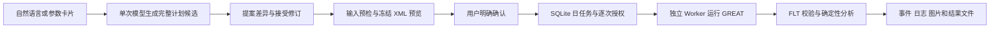
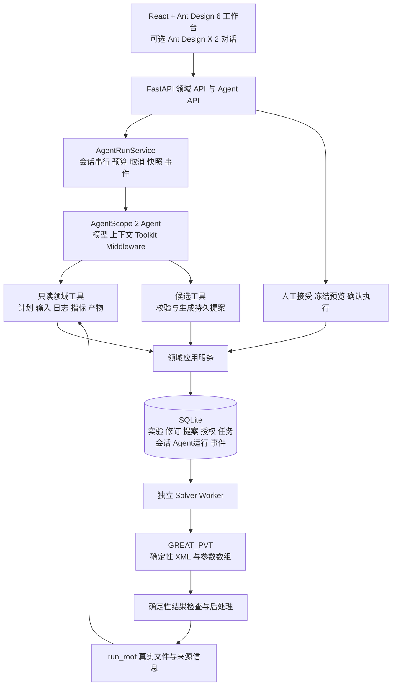

# GREAT Agent 基于 AgentScope 和 Ant Design 的重构技术方案

日期：2026-11-02。状态：用户已批准推荐路线并授权实施 P0/P1；P2 及以后待后续评审。调研对象为当前工作区，包含未提交修改；基线 HEAD 为 `f14abd6bd9f9a9ba0d0f7b5d888667cd51ef5180`，不能用该提交单独代表本文审查的现状。

建议采用 **AgentScope Python 2.0.11 的 SDK 构建 Agent 层，保留 FastAPI、SQLite 和独立 Solver Worker；前端保持 React/Vite，迁移至 Ant Design 6，对话区按需采用 Ant Design X 2**。核心原则是让 Agent 理解意图、读取证据和提出操作，由确定性服务掌握计划版本、科研计算和执行授权。

用户已批准推荐技术路线、本机单用户 PPPFLT 范围，以及先做 P0/P1 的实施次序。默认继续服务 Windows 本机单用户，保持现有 PPPFLT 工作流；服务器多人部署、B2bOut PVTFLT/UPD 全链路编排作为后续扩展点。

实施状态：P1 已完成并通过 231 项后端、64 项前端测试及独立复审；P0 安装/离线/构建及配置模型 `glm-4.7` 的三项真实合成探测通过，最新请求 3 次、live 11.234 秒、退出 0。主路径尚未切换，P2/P3 尚未开始。详见 [P0/P1 实施验收](/F:/GREAT_Agent/docs/validation/2026-11-02-p0-p1.md)。下文“现状判断”记录的是实施前调研基线。

## 1 现状判断

### 1.1 当前并非 AgentScope 应用

现有系统的真实主链路为：



`ModelProvider` 仅提供 `propose_plan(message, current)`，`OpenAICompatibleProvider` 发送一次非流式模型请求，携带当前完整计划与本次文本。没有框架管理的工具循环、后端多轮消息、Agent run 或工具轨迹。依赖中没有 AgentScope。前端只有 React/react-dom，现有组件和 CSS 为自行实现，没有 antd 或 Ant Design X。

证据：[模型接口](/F:/GREAT_Agent/backend/src/great_agent/adapters/model_provider.py:31)、[模型请求](/F:/GREAT_Agent/backend/src/great_agent/adapters/openai_compatible.py:30)、[依赖](/F:/GREAT_Agent/pyproject.toml:9)、[前端依赖](/F:/GREAT_Agent/frontend/package.json:14)。原设计将多 Agent 与长期自主科研列为首版非目标，因此这是下一阶段的能力演进。[原设计](/F:/GREAT_Agent/docs/superpowers/specs/2026-10-09-great-agent-design.md:62)

### 1.2 已有资产应继续承担职责

| 已有资产 | 保留原因 | 代码依据 |
|---|---|---|
| ExperimentSpec、日期展开、DF/TF 产品规则 | 专业规则可以确定性验证，无需由模型重新实现 | [计划](/F:/GREAT_Agent/backend/src/great_agent/domain/plans.py:33)、[日期](/F:/GREAT_Agent/backend/src/great_agent/domain/dates.py:29) |
| PlanService 修订、diff、CAS 与冻结 | 维持卡片和对话共用一套计划事实 | [PlanService](/F:/GREAT_Agent/backend/src/great_agent/services/plan_service.py:146) |
| ExecutionPreview、Approval 和 attempt 授权 | 绑定实际 XML、程序、模板及输入快照，API 与 Worker 可独立重验 | [ExecutionService](/F:/GREAT_Agent/backend/src/great_agent/services/execution_service.py:46) |
| Worker、ProcessRunner、TaskRepository | 长时间 GREAT 解算不占用聊天生命周期，重试保留旧 attempt | [Worker](/F:/GREAT_Agent/backend/src/great_agent/runtime/worker.py:88) |
| PPPFLT XML 适配与结果检查 | 约束路径、命令数组、测站输出和领域参数 | [适配器](/F:/GREAT_Agent/backend/src/great_agent/adapters/great_pppflt.py:127) |
| ENU、CDF、收敛分析与来源信息 | 计算口径可追溯；模型只解释结果 | [结果分析](/F:/GREAT_Agent/backend/src/great_agent/runtime/result_analysis.py:45) |
| 三栏工作台和独立执行复核页 | 已对应实验历史、工作区和对话的实际科研流程 | [工作台](/F:/GREAT_Agent/frontend/src/pages/ExperimentWorkspace.tsx:112)、[复核页](/F:/GREAT_Agent/frontend/src/pages/ExecutionReviewPage.tsx:22) |

当前预览有效期为 30 分钟，已确认排队任务的授权不因等待超过此期限失效。程序、模板和 XML 使用 SHA256；输入文件当前使用路径、大小和 mtime 快照。不能把后者表述为输入内容已全量哈希。是否增加大 GNSS 文件的内容摘要，由数据规模和成本决定。[授权校验](/F:/GREAT_Agent/backend/src/great_agent/services/execution_service.py:194)

### 1.3 接入 Agent 前必须补齐的契约

| 问题 | 当前事实 | 重构处理 |
|---|---|---|
| 校验阶段不统一 | 候选/接受阶段主要重新构建 Pydantic DTO；闰年、逆序日期和最终空集合到 expand_dates 才检查 | 统一 PlanValidationService，候选、接受、冻结使用同一领域校验 |
| 实验并发字段没有落实 | Worker 使用全局 max_concurrency；claim SQL 未按实验 concurrency 限流 | 在 SQLite 原子领取事务中同时检查全局和每实验配额 |
| 提案依赖 API 进程内存 | AppServices.proposals 为字典，API 重启会丢失 | 新增持久化 proposals，绑定生成时 base_revision_id 和 candidate hash |
| profile ID 尚未成为真实资产引用 | DTO 有 solver/input/template_profile_id，适配器仍使用统一注入配置 | 先把现有默认配置注册为真实 profile；未知 ID 拒绝 |
| Agent 与任务状态尚未分层 | 没有 Conversation/AgentRun/ToolCall 模型 | 新增 Agent 数据域，保留 SolverTask/Attempt 数据域 |
| 前端任务订阅偏重 | 每个日任务一条 SSE，断连后 0ms 重连；分析完成事件未用于刷新产物 | 先补退避和事件失效刷新，再提供实验聚合事件流 |

这些判断来自源码审查，尚未用专门的行为测试复现全部边界；实施阶段应先补行为基线。证据：[校验](/F:/GREAT_Agent/backend/src/great_agent/services/plan_service.py:261)、[领取](/F:/GREAT_Agent/backend/src/great_agent/db/repositories.py:130)、[Worker 配额](/F:/GREAT_Agent/backend/src/great_agent/runtime/worker.py:51)、[提案内存](/F:/GREAT_Agent/backend/src/great_agent/api/dependencies.py:24)、[前端订阅](/F:/GREAT_Agent/frontend/src/pages/RunDashboard.tsx:29)。

## 2 AgentScope 版本与技术路线

### 2.1 推荐固定 2.0.11

调研时官方 stable 文档指向 2.0.11；对应 GitHub tag 的提交为 `8af9d25784e704a4b11d71bd673257c68505fcb8`。`latest` 文档已指向 `2.0.12dev`，不宜作为稳定实现的唯一依据。[稳定文档](https://docs.agentscope.io/stable/en/index)、[固定发布](https://github.com/agentscope-ai/agentscope/releases/tag/v2.0.11)、[官方文档索引](https://docs.agentscope.io/llms.txt)

| 维度 | AgentScope 1.x | AgentScope 2.0.11 | 本项目选择 |
|---|---|---|---|
| Agent 入口 | ReActAgent、AgentBase | Agent + AgentState | 采用 2.x，避免编写即将迁移的接口 |
| 状态接口 | StateModule、state_dict/load_state_dict、session 管理 | 显式 AgentState，包含 context、reply、permission、tool 等上下文 | 产品拥有数据库，保存带版本的框架状态快照 |
| 扩展行为 | hooks 等机制 | middleware、工具权限和事件系统 | 用中间件接入预算、审计、领域上下文 |
| 流式 UI | 可实现，需按 1.x 接口适配 | Agent.reply_stream 直接产生 AgentEvent | 转换为本项目 ProductEvent |
| 迁移成本 | 能完成首版需求，但日后需再迁移 | 本轮即处理破坏性 API 变化 | 先做兼容性验证后落地 |

这里的 1.x 判断来自已读取的版本源码和旧版教程，不代表对所有 1.x 补丁版本逐个验证。1.x 也有中断、结构化输出、状态和工具能力，不能以“1.x 做不到”作为升级理由。[1.x 入口](https://github.com/agentscope-ai/agentscope/blob/v1.0.0/src/agentscope/agent/__init__.py)、[1.x 教程](https://doc.agentscope.io/tutorial/task_agent.html)、[2.x 入口](https://github.com/agentscope-ai/agentscope/blob/v2.0.11/src/agentscope/agent/__init__.py)

**2.x 设计使用 `Agent`，不使用 1.x 的 `ReActAgent`、`sys_prompt`、`JSONSession` 示例直接拼装。** SDK 版本通过 uv.lock 精确锁定；升级须重跑模型、状态反序列化、事件和工具合同测试。Python 继续使用项目现有 3.11；2.0.11 的包声明要求 Python >=3.11。[2.x 包声明](https://github.com/agentscope-ai/agentscope/blob/v2.0.11/pyproject.toml)

### 2.2 三条可选路线的比较

| 路线 | 好处 | 代价与适用性 |
|---|---|---|
| 在现有 provider 上继续自建工具循环 | 最少外部依赖 | 需要自行维护上下文、工具回填、中断、流事件，不满足用户以 AgentScope 为主体的方向 |
| **AgentScope SDK + 现有领域内核** | 复用框架的实际 Agent 循环，保留科研和授权能力，迁移范围可控 | 需要一层领域工具、状态存储及产品事件适配；推荐 |
| 整体换为 AgentScope Agent Service 与官方 Web UI | 可获得通用会话、后台管理和部署能力 | 会迁移既有实验/授权存储，且官方 UI 使用 shadcn/Radix/Tailwind，不能直接满足 Ant Design 方向 |

AgentScope 2 自带服务是可选的部署路线，不要求本项目同时引入 AgentScope Runtime、Redis、MongoDB、Kubernetes 或另一套微服务。SDK 主路径可以嵌入现有 FastAPI。官方完整前端适合作为协议参考。[官方服务概述](https://github.com/agentscope-ai/agentscope/blob/v2.0.11/README.md)、[官方 UI 依赖](https://github.com/agentscope-ai/agentscope/blob/v2.0.11/examples/web_ui/frontend/package.json)

### 2.3 首个验证关口是现有模型兼容性

当前使用 GLM-4.7 兼容端点、thinking 控制、JSON mode、整次 180 秒 deadline。不能把“兼容 OpenAI”视作完整兼容 AgentScope 工具循环的证明。

AgentScope 2.0.11 的 OpenAIChatModel 会发送 tools/tool_choice，流式时附带 stream_options；参数中的 max_tokens 实际映射成 max_completion_tokens。模型层默认 max_retries=3。基础结构化输出还有多策略 fallback，不能只把重试设为 0 就认为永远只有一次模型请求。[OpenAI 模型实现](https://github.com/agentscope-ai/agentscope/blob/v2.0.11/src/agentscope/model/_openai_chat/_model.py)、[结构化输出实现](https://github.com/agentscope-ai/agentscope/blob/v2.0.11/src/agentscope/model/_base.py)

P0 验证矩阵必须覆盖：tools 与 tool_choice、参数 JSON 拼接、模型流结束、usage、max_tokens/max_completion_tokens、thinking、取消清理、schema 不支持、4xx/429/5xx、连接及总 deadline。先用录制/模拟 transport 验证请求，再用配置模型做小样本兼容验证，记录请求次数和耗时。

优先使用框架现有 OpenAIChatModel 的公开配置。若字段映射仍不兼容，编写小型供应商模型适配器，遵守 ChatModelBase 的扩展合同；不修改 AgentScope 内部循环。初始版本关闭 SDK、模型和外层自动重试，禁用未经明确预算控制的结构化多策略尝试；框架发生额外请求也应被同一总请求/令牌预算拦截。简单改参通过一次受控 propose_plan 工具返回候选，减少无效多轮。

若验证失败，暂停切换主路径，保留现有 JSON 提案功能及手工卡片；输出兼容问题和修正方案。若要改用 1.x，先作为独立 ADR 重新锁版本，不能让两代 API 同时存在于正式主路径。

### 2.4 GitHub 个人项目对路线的启发

本次选择三个可核查关键源码的个人账号/个人发起项目，分别代表轻量 Agent、完整 Agent 应用、领域专用编排。个人发起不等于今天仍由一人维护；固定提交是研究快照，不声称为实时 HEAD。

| 样本与固定提交 | 源码中的路线 | 对 GREAT 的取舍 |
|---|---|---|
| [cn-vhql/AS_SKILLS](https://github.com/cn-vhql/AS_SKILLS/tree/837b410a9e65b2e9b58b42b9e96d927f28c15ea3) | AgentScope 1.0.6；一个 ReActAgent 子类、Toolkit、技能管理和内存会话，终端交互 | 借鉴小规模显式装配；不照搬任意 Python 工具自动发现；不能当作已完成网页/沙箱/恢复的样板 |
| [RandyChen1985/nanzi-ai-agent-platform](https://github.com/RandyChen1985/nanzi-ai-agent-platform/tree/2b6ab2c61dc68277fe27b95d7a2da3382d12067f) | 固定 AgentScope 2.0.11；独立 runner、事件适配、版本化状态 envelope；实际前端 Vue/Pinia | 借鉴框架与产品协议分层及工具指纹；本项目继续 React/antd 与 SQLite，不复制多租户和全套平台 |
| [666ghj/BettaFish](https://github.com/666ghj/BettaFish/tree/c4ca6360489b53c38d3d41d213a67b50d2fcb883) | QueryEngine 自建研究节点和有界反思；Flask + 多个 Streamlit 进程，Forum 从日志协调 | 借鉴领域步骤和结构化研究证据；本项目使用已有数据库事件，不解析日志编排解算 |

对应关键证据：[AS_SKILLS Agent](https://github.com/cn-vhql/AS_SKILLS/blob/837b410a9e65b2e9b58b42b9e96d927f28c15ea3/src/skilled_react_agent.py)、[NanZi runner](https://github.com/RandyChen1985/nanzi-ai-agent-platform/blob/2b6ab2c61dc68277fe27b95d7a2da3382d12067f/app/services/ai/runners/assistant_agent_runner.py)、[NanZi 状态](https://github.com/RandyChen1985/nanzi-ai-agent-platform/blob/2b6ab2c61dc68277fe27b95d7a2da3382d12067f/app/services/ai/runtime/agentscope/state_store.py)、[BettaFish QueryEngine](https://github.com/666ghj/BettaFish/blob/c4ca6360489b53c38d3d41d213a67b50d2fcb883/QueryEngine/agent.py)。

这些样本支持“薄框架适配层 + 明确的领域服务”这一设计推论；它们没有验证 GREAT 的数值正确性、执行授权或 Windows 部署性能。详尽源码路径、依赖核实和不适用点见调研依据。

## 3 目标架构与职责



### 3.1 Agent 层必须真正使用框架

第一阶段一个 `ResearchCoordinator` 即可：由 AgentScope `Agent` 执行模型—工具—观察循环，使用 `Toolkit` 注册有类型的领域工具，使用 `AgentState` 保存上下文，使用 middleware 注入当前 revision、限制预算并记录工具轨迹。应用只编写适配和业务规则，不另建一套 ReAct while 循环。[Agent 实现](https://github.com/agentscope-ai/agentscope/blob/v2.0.11/src/agentscope/agent/_agent.py)、[工具入口](https://github.com/agentscope-ai/agentscope/blob/v2.0.11/src/agentscope/tool/__init__.py)、[状态实现](https://github.com/agentscope-ai/agentscope/blob/v2.0.11/src/agentscope/state/_state.py)

按任务选择提示词与工具集合：计划讨论使用计划/预检工具，运行诊断使用状态/限量日志工具，结果问答使用指标/来源工具。第一阶段不为“规划者、审查者、执行者、绘图者”各建一个模型角色；数值审查和执行均由确定性代码负责。后续仅在评测显示有收益时增加只读 `ResultAnalyst` 或领域顾问；其输出回到协调 Agent，不能修改授权。

### 3.2 领域工具和人工操作边界

| 类别 | 拟提供的操作 | 约束 |
|---|---|---|
| 只读工具 | get_experiment、get_plan、inspect_inputs、get_task_status | 服务端绑定实验和 revision，输入检查需异步调度避免阻塞 API |
| 只读工具 | read_log_excerpt、list_artifacts、read_analysis、compare_analysis | 仅访问已登记 attempt；限制分页、字节数和结果数；比较核对共同参考与口径 |
| 候选工具 | propose_plan | 受控字段补丁合并后严格校验，返回 proposal_id、base_revision、diff 和说明；不接受修订 |
| 解释工具 | explain_parameter；后续 search_domain_docs | 返回带来源和版本的材料；检索内容是证据，不是工具授权 |
| 纯 UI 操作 | 接受提案、生成 XML/冻结预览、最终确认、重试预览、停止实验 | 调用领域 API；不注册为模型可调用工具 |

这里把“生成 XML 预览”保留为用户动作，因为当前实现会冻结计划。Agent 可以给出“准备执行复核”的操作卡片，但点击后才调用冻结服务。既不能自动冻结，也不能把自然语言“可以运行”转成 confirmed=true。

每次工具调用由服务端注入 experiment_id/session_id 与访问范围，模型不能以参数切换其他实验。工具结果返回业务 ID、结构化摘要、artifact 引用和证据位置。候选工具仅允许计划 schema 中的业务字段，不接收任意命令、程序路径或 XML；不开放通用 shell、代码写入和任意文件读取工具。

AgentScope 的通用 Permission/HITL 控制是附加保护；**真正启动 GREAT 的授权仍然是 ExecutionApproval**。即使通用工具被允许，也不能替代 revision、preview、程序/模板 SHA256、XML 字节与输入快照校验。

### 3.3 保留科研计算的事实来源

LLM 读取 analysis.json、summary.csv、cdf.csv 和已登记图像引用，负责解释“哪些站不收敛、可能原因、下一步建议”。RMS、STD、ENU、固定率和收敛时间继续由现有分析器计算。

结果解释必须标注 reference_experiment、日期、station、attempt、分析配置/算法版本及输入来源。当前“同日 DF Float 最后有效历元参考”对应相对稳定性分析；没有外部真值时，不将指标描述为绝对定位精度。比较不同方案前先检查共同参考、采样窗口、测站集合和统计口径。

初始知识支持采用仓库文档、参数说明和案例索引的只读检索。先建立版本与段落引用，再根据真实检索评测决定是否加向量索引；不默认部署大型 RAG 服务。原始 GNSS 文件和完整日志不整段上传模型；使用按需摘要和限量片段。

## 4 持久化 幂等和恢复

### 4.1 三类状态各有所有者

| 数据域 | 事实来源 | 生命周期 |
|---|---|---|
| 实验与解算 | 既有 experiment/revision/preview/approval/task/attempt/artifact 表 | 可长期审计；由领域服务修改 |
| 产品对话与 Agent 运行 | 新增 conversation/message/agent_run/tool_call/proposal/event 表 | 刷新可恢复；由 AgentRunService 修改 |
| 框架工作状态 | AgentState 的带版本快照 | 为上下文恢复服务，不作为计划或授权事实 |

建议新增表：

- `conversations`：experiment_id、标题、状态；一个实验可有多条会话，默认打开最近会话。
- `messages`：conversation_id、role、业务内容块、status、source_agent_run_id、created_at；产品可见消息独立于框架内部格式。
- `agent_runs`：conversation_id、client_request_id、base_revision_id、status、deadline、token/request/tool 预算、错误分类及时间指标。
- `tool_calls`：agent_run_id、framework_tool_call_id、tool_name、canonical_input_hash、status、受限结果引用、耗时。
- `plan_proposals`：experiment_id、base_revision_id、candidate、candidate_hash、diff、source_run_id、status。
- `agent_snapshots`：conversation_id、snapshot_version、framework_version、toolset_version、state_json、last_event_sequence。
- `agent_events`：agent_run_id、sequence、event_id、payload；约束 run 内序号唯一。

上述为建议模型，不直接复用框架的内部表名。既有 Alembic 版本顺序以实施时仓库 head 为准，不能假设下一个一定是 0003。

### 4.2 每个会话串行 每个写操作可判重

本机首版运行一个 API 进程和一个 Solver Worker；同 conversation 只允许一个活动 AgentRun，数据库约束/条件更新为准，内存锁只是优化。其他会话可并行，初始模型并发上限建议 2，与 solver 并发分开配置。

`client_request_id` 在会话内唯一，重复创建返回已有 run。写工具以 run + tool_call + 输入 hash 判重；返回候选前将 proposal 与工具结果登记到同一业务事务。重复流回放不会重新执行工具。提案接受同时验证提案 base_revision 与当前 revision、客户端 expected_revision；旧候选应标记 stale，不能靠客户端换一个 revision 数字继续接受。

**候选编辑也不能重新绑定基线。** 手工卡片首次创建提案时必须携带所编辑版本的 `base_revision_id`；编辑已有提案时必须携带 `source_proposal_id`，服务端从原提案继承不可变基线，并校验客户端基线一致。Agent 候选基线固定为该 run 开始读取的版本。创建、派生或接受时发现当前版本变化，统一返回 revision_conflict，不创建一个绑定最新版本的旧完整候选。用户可以显式选择基于最新版重新提出修改：服务端重新应用所选字段补丁，重新校验并计算新 diff，生成新的提案，必须再次复核；不自动重放旧完整 spec。

计划修订、执行确认继续保留现有 CAS 与幂等事务。新计划校验服务在候选、接受、冻结处共用，但输入文件存在性和快照重验仍在预检/确认/启动时执行，避免把短暂文件状态误当永久保证。

### 4.3 模型运行与解算运行分别恢复

AgentRun 状态建议为 pending、running、cancel_requested、completed、failed、cancelled、interrupted。出现待接受提案时，run 可以 completed 并留下持久 action card；不保留一个等待数小时的 Python 协程。

在接收/工具完成/回复结束等可恢复边界保存 AgentState。进程在工具执行后、快照前退出时，先查持久 tool ledger：已完成的写操作返回原结果；状态不明时标为 interrupted 并让用户重试，不能自动重放有副作用的动作。模型请求中断后不声称可从原供应商 token 位置续生成；UI 显示中断，下一次请求从已保存消息/快照启动。

加载快照时校验 framework_version、snapshot_version 和 toolset_version/工具指纹。兼容迁移器存在时显式迁移；否则保留旧快照用于排查，从产品消息、当前领域状态和已完成工具记录重建上下文，清除失效的待执行工具与通用权限。不得将无法反序列化的会话静默当作成功恢复，也不能因快照不兼容删除实验历史。

Solver Worker 按既有授权和 attempt 恢复；API、浏览器、Agent 取消均不能隐式撤销已经确认的解算。取消解算必须走独立 stop 操作。当前恢复主要检查 PID；首版保留单 Worker 部署约束。若未来支持多 Worker/服务器，再加入 worker instance、heartbeat、lease、fencing 和 PID 创建时间校验，不能只增加进程数。

### 4.4 数据迁移和隐私

采用增量 Alembic 迁移，新表不重写旧 task/attempt，历史运行目录保持不动。旧浏览器内存对话无法追溯补全；历史实验仍可读取，并可创建新的持久会话。现有进程内未接受 proposal 无法在重启后自动恢复，需要重新生成。

聊天持久化是相对当前行为的一项明确变化：新增对话删除/保留策略，界面说明消息保存在本机数据库；模型密钥仍仅来自环境，不进入消息、快照或浏览器。日志/追踪默认仅保存 ID、阶段、耗时、token 与受限工具摘要；不默认开启完整 prompt 或供应商错误正文追踪。备份仍需同一时点的数据库与 runs。

## 5 API 与事件合同

保留 `/api/v1/chat/proposals` 作为迁移期旧接口，它继续保持请求断连即取消的原语义。新的 Agent UI 使用独立 run API，避免把持久运行与旧接口混成两种行为。

| 拟新增接口 | 作用 |
|---|---|
| POST /api/v1/experiments/{id}/conversations | 建立绑定实验的会话 |
| GET /api/v1/conversations/{id}/messages | 分页恢复产品消息 |
| POST /api/v1/conversations/{id}/runs | client_request_id + message 创建 run，尽快返回 run_id |
| GET /api/v1/agent-runs/{id} | 获取状态、已形成的提案和最终消息 |
| GET /api/v1/agent-runs/{id}/events | SSE，支持 Last-Event-ID 与持久回放 |
| POST /api/v1/agent-runs/{id}/cancel | 显式取消，返回实际状态 |
| POST /api/v1/experiments/{id}/proposals，升级请求合同 | 新增 base_revision_id 和可选 source_proposal_id；手工与派生卡片统一验证不可变基线 |
| GET /api/v1/experiments/{id}/events | 后续聚合 solver 事件；保留旧 task 流兼容 |

新 run 不因 SSE 断开而取消，浏览器刷新可重连。点击取消、切换实验或离开工作台时，前端明确发送 cancel 并停止消费旧 run；服务器按取消/完成的原子状态决定结果。若完成先于取消，返回 completed，页面仍按 run_id 隔离迟到事件，不自动接受提案。已完成的候选只作为 pending proposal 保留。

事件使用本项目的产品 envelope，初始 schema_version 为 1；至少包括 event_id、stream_id、sequence、type、created_at、experiment_id，以及适用的 conversation_id、run_id、task_id、attempt_id、base_revision_id、data。sequence 只在各自 stream 内单调；聚合 solver 流需使用数据库聚合游标，不能把各 task 的 sequence 直接拼成全局顺序。

| 产品事件 | 可产生的 UI 行为 |
|---|---|
| agent.run.started、agent.stage.changed | 显示请求受理、读取计划/检查输入等公开阶段 |
| chat.text.delta | 追加普通回答文本，不修改计划 |
| tool.started、tool.completed | 显示工具、耗时与受限业务摘要 |
| proposal.ready | 仅在候选完整校验并已持久化后展示可接受卡片 |
| agent.run.completed/failed/cancelled/interrupted | 收敛请求状态，恢复控件并给出可读错误 |
| task.status、analysis.completed/failed/skipped、execution.blocked | 精准刷新任务、日志、产物和异常提示 |

`AgentEvent → ProductEvent` 转换位于后端适配器；前端不导入 AgentScope 内部消息类型。只展示公开说明、工具执行和证据，不直接转发模型 thinking 内容。浏览器对 envelope 与业务 payload 做运行时校验，未知事件安全忽略并记录协议版本。

SSE 解析覆盖 UTF-8 分片、跨 chunk JSON、CRLF、多行 data、注释 heartbeat 与终止事件。客户端按 stream_id + sequence 去重并做指数退避，例如 0.5/1/2/4 秒到 15 秒并加入抖动；页面卸载关闭订阅。文本增量可合并成小批持久化并由最终消息快照兜底，避免每 token 一次 SQLite 写事务。回放过期应返回需要重新拉取快照的明确响应。

## 6 Ant Design 前端重构

### 6.1 技术选择

保留 React 19、TypeScript、Vite 与当前信息架构，新增 antd 6 和对应 icons 6；具体补丁号在 P0 验证后锁入 package-lock，不跟随浮动 latest。antd 6 支持 React >=18，React 19 无需 v5 补丁。[官方版本说明](https://ant.design/docs/react/migration-v6/)

对话区可以采用 `@ant-design/x` 2 的 Bubble.List/Sender，但第一阶段不强制引入 x-sdk、动态卡片或通用模型 provider。X 2 已移除 useXAgent 并拆分运行时 SDK，不能照搬 X 1 的示例。[X 2 迁移说明](https://x.ant.design/docs/react/migration-v2/)

本轮不要求 Next.js、Ant Design Pro/Umi、Redux 或 Zustand。先使用 feature hooks/reducer；随着持久会话、事件刷新落地，可选用一个 server-state 库统一查询缓存。不能让 X SDK、Query 和局部状态各保存一份互相竞争的消息事实。

### 6.2 组件迁移映射

| 工作区 | Ant Design 组件 | 必须保持的行为 |
|---|---|---|
| 三栏 | Splitter + 业务布局包装 | 受控尺寸、最小宽、比例记忆、恢复默认、键盘调整、窄屏区域切换 |
| 左侧实验历史 | Card/Menu、Badge、Tag | 读历史不创建、不重跑，显示真实状态 |
| 中间四视图 | Tabs | 切参数/XML/图片/进度不卸载右侧会话 |
| 参数和差异 | Descriptions、Tag、Card、Form | 已接受 spec 与待接受 candidate 分开；编辑后重新校验 |
| 输入和日任务 | Table、Select、Alert | 长 Windows 路径可读，每行绑定日期/task/attempt |
| 执行复核 | Steps、Descriptions、Collapse、Checkbox | 保留独立复核页、完整 XML、精确命令数组及明确确认 |
| 日志与图片 | 专用日志 viewer、Image、Empty、Skeleton | 真实登记产物，手选历史 attempt 不被新状态抢走 |
| 对话 | X Bubble.List、Sender 或 antd 基础组件 | 取消、耗时、会话恢复、内嵌强类型 ProposalCard |

Splitter 的鼠标能力可直接映射，键盘可访问性和边界宽度须用现有行为验收；如库组件不能覆盖，保留包装层实现，不为了换组件丢功能。[Splitter 文档](https://ant.design/components/splitter/)

XML 继续用安全文本节点着色，保证文本内容不变；不以 HTML 注入或模型生成 HTML 取代。执行确认复选框不写入持久缓存，切换预览/逐日 XML、过期、提交后按原行为清空。主题通过 ConfigProvider tokens 统一，保留当前科研工作台的蓝色主色、灰白背景与深色 XML。

### 6.3 前端模块边界

```text
frontend/src/
  app/                       应用装配 URL 导航 主题
  features/experiments/       历史 实验与接受版本
  features/chat/              会话 消息 AgentRun 与取消
  features/proposals/         候选 编辑 diff 和接受
  features/execution/         预览 冻结 确认与重试复核
  features/tasks/             监控 日志 attempt 与产物
  shared/api/                 客户端 类型 事件解析与校验
  shared/ui/                  工作台布局 XML 和领域组合控件
```

当前生产 TS/TSX 约 19 文件，存在多处巨型单行；先格式化并抽职责，不能用物理行数较少推断简单。拆分 ExperimentWorkspace 中的消息请求、提案状态、预览导航和任务订阅，再替换控件，可让外观回归和状态回归分开定位。

## 7 后端建议模块布局

```text
backend/src/great_agent/
  agent/                     新增 AgentScope 集成边界
    factory.py               版本对应的 Agent 模型 工具和 middleware 装配
    coordinator.py           领域角色和任务工具集合
    tools/                   仅读取和生成候选的领域工具
    middleware/              预算 日志 领域上下文
    state_store.py           AgentState 快照的版本封装
    event_adapter.py         AgentEvent 到 ProductEvent
  services/
    agent_run_service.py     新增 生命周期 幂等 会话串行
    plan_validation_service.py 新增 统一领域验证
    plan_service.py          保留 修订 接受 冻结
    execution_service.py     保留 审阅授权内核
    result_analysis_service.py 保留 确定性分析入口
  capabilities/              新增 轻量注册表和 profile
  runtime/                   保留 Solver Worker 与进程/数值实现
  domain/                    保留并完善规则模型
  db/                        增量表与仓库
  api/                       新增 Agent API 保留领域 API
```

第一阶段能力注册表只登记真实已有的 `pppflt.solve`、`pppflt.analyze`，字段包含版本、输入/输出 schema、profile、执行器、验证器和副作用类别。`pppflt.solve` 由人工确认的 Worker 调用，不等于给模型增加 solve 工具。未来 PVTFLT/UPD 可以使用同一能力接口和上游产物引用，但本轮不实现完整工作流引擎。

## 8 分阶段实施与回滚

以下为实施路线和验证关口，不是已执行的开发工作。人日估计假设一位熟悉代码的全栈开发者，模型兼容问题、真实数据规模和评审会影响排期。

| 阶段 | 范围与可交付结果 | 验收关口 | 估计 |
|---|---|---|---|
| P0 基线和兼容验证 | 隔离模型/工具/流式 spike、依赖锁定方案、现有行为清单；核清测试环境问题 | Windows/Python3.11/React19 可安装构建；配置模型兼容证据完整 | 2–3 人日 |
| P1 稳定领域合同 | 统一计划校验、真实默认 profile、全局/实验两级调度配额、持久提案与 base revision，同时更新旧 UI 请求字段 | 非法候选不能接受，旧提案不能覆盖新修订，配额生效 | 3–5 人日 |
| P2 建立 Agent 主路径 | 单协调 Agent、领域工具、会话/消息/run/tool/snapshot、预算和取消 | 可多轮问答/改参/查任务；重启保留历史；没有人工确认时 solver task 为零 | 4–6 人日 |
| P3 Ant Design 与产品事件 | 控件渐进替换、X 对话可选、SSE 适配和回放、分析完成刷新 | 三栏/卡片/复核行为不退化，断连可恢复，跨实验事件隔离 | 4–6 人日 |
| P4 科研解释和评测 | 带来源结果解释、共同参考比较、参数文档检索、失败案例集 | 数值引用一致、无依据结论可识别，预算与耗时可观测 | 3–5 人日 |

总估计 16–25 人日。P1 完成后，后端 P2 与前端基础组件迁移可以并行；P3 的流式 UI 依赖 P2 产品协议。知识检索增强、额外 Agent、多人部署和上游流程不计入这一区间。

建议新增 `agent_mode=legacy|agentscope` 配置，切换前保留旧提案入口；前端可以独立完成 antd 迁移。数据库只增表和必要索引，不删除旧字段；回滚应用时保留新表。旧代码回滚只允许打开已验证兼容的新数据库，不能假设降级迁移安全。冻结 XML、授权和 runs 目录在切换过程中保持原身份和引用。

## 9 验收标准和观测

### 9.1 执行与科研不变量

1. 任意聊天、工具调用、提案、XML 预览后，人工确认前新增 solver task 数始终为 0。
2. 确认重发不增加重复任务；两个竞争初始预览不能重复授权同一批日期。
3. 同时运行数满足全局与实验限额；同 attempt 不被两个 Worker 执行。
4. 模型失败/取消/网页断连不改变已接受版本，也不停止已授权解算。
5. 过期或已变更的预览不能确认；启动前仍检查授权及文件快照；重试创建新 attempt 并再次复核。
6. 同一固定输入的日期集合、XML 语义、任务数及现有 ENU/STD/RMS/CDF/收敛结果保持基线一致。

### 9.2 Agent 与 UI 的新行为

建立约 40 条人工核定用例：参数解释、跨轮指代、跨年/非法日期、DF/TF 产品依赖、缺输入、修订冲突、进程失败、分析失败、共同参考比较、模型超时及工具越界。每条列出预期领域状态和证据，不以回答文风代替正确性。

确定性门禁与协议测试要求全部通过。模型小样本中，建议有效候选/正确澄清比例至少 95%，解释数值应全部可定位到真实分析产物；未经人工确认触发解算、修改源 GNSS、伪造完成或引用不存在产物均为零容忍失败。该比例是建议验收门槛，尚未测得；样本数量和难度须随真实任务更新。

UI 验收覆盖窄屏、长路径、拖拽/键盘、切 tab 保留卡片、编辑重验且继承提案基线、多会话/页签交错修改、取消/迟到响应、旧提案失效、复核勾选重置、历史 attempt、事件重复/断线/CRLF/分块、analysis 完成后产物刷新。测试断言业务可见行为，不锁定 antd 内部 DOM。

### 9.3 性能和预算口径

分别记录请求受理时间、首个产品事件、首个模型文本、工具耗时、完整回答/候选时间、模型请求数、token、取消确认时间。现有 API 总耗时不能当作首 token 延迟。

初始建议每 run 总 deadline 180 秒、最多 8 个推理轮次、12 次领域工具调用，最多两个并发模型 run；令牌总预算按实际配置模型上下文和成本设定，并包含结构化 fallback/压缩调用。受理事件本机 p95 目标 <=500ms，不将其宣传为模型首 token 性能；模型耗时目标在 P0 实测后按相同任务与当前实现比较。

SQLite 高频事件批量写入，长日志按范围读取，文件预检/绘图不得阻塞 FastAPI 事件循环。Solver Worker 继续独立运行。首版不因性能猜测引入 Redis/Celery；只有队列积压、多用户或跨机器需求出现时再评估。

## 10 需在 P0 关闭的事项

| 事项 | 当前处理决定 |
|---|---|
| 配置 GLM 端点是否支持待用的 2.x 工具/流式参数 | P0 已对 glm-4.7 完成 3 次真实合成检查：两种 token 字段工具流和 JSON-object 均通过；复杂工作流及产品接入仍在 P2 验证 |
| 对话保存时长 | 建议默认本地保存并支持用户删除，具体保留天数可作为配置；不影响主架构 |
| Ant Design 和 X 补丁版本 | 推荐主版本，安装/构建验证后锁定精确补丁；不提前声称已集成 |
| 多人/服务器是否当前必须 | 当前按本机单用户设计；若改为多人，需增加身份、资源权限和部署工作包 |
| 外部真值或参考坐标 | 沿用现有临时参考口径并明确标记；引入外部真值需要单独的数据/算法验收 |

本轮源码与公开项目调研、固定版本依据、测试执行记录见[调研依据](/F:/GREAT_Agent/docs/research/2026-11-02-agent-framework-evidence.md)。
