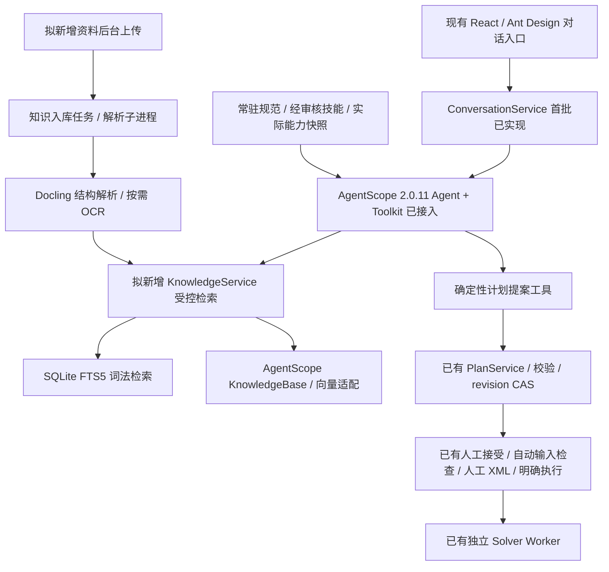

# 统一 GNSS 对话、技能与科研知识库技术方案

日期：2026-11-02。状态：**用户已批准分阶段执行；原生Agent/统一会话首批已实现，知识库部分待后续批次**。依据见 [GitHub源码调研](../../research/2026-11-02-conversation-knowledge-evidence.md)，实际交付边界见 [P2首批验收](../../validation/2026-11-02-p2-conversation-foundation.md)。本文同时包含目标架构，不表示论文RAG或后台上传已经上线。

## 1. 目标和设计假设

一个输入框处理普通GNSS理论、当前计划解释、资料问答、明确的参数修改，以及它们的混合请求。咨询不产生无意义提案，修改不直接接受或执行。资料是参考证据，技能是处理方法，能力事实由后端实际服务提供。

设计时的改造起点：[ModelProvider](../../../backend/src/great_agent/adapters/model_provider.py) 只有propose_plan，ModelPlanProposal强制candidate，旧ChatService成功后进入提案流程。当时尚无会话表；本轮已增加独立ConversationService/原生Agent和四张会话表，旧路径保留兼容。论文knowledge表与来源引用仍未新增。此前测站与输入检查修复保持。

用户未确定资料规模和格式。初期按Windows本机个人使用设计；数百篇中英混合资料、部分扫描件是容量验证场景，不是用户已确认的现状。初版保持单API进程和现有SQLite，提供升级独立向量服务的边界。多用户部署另行设计身份与库权限。

| 输入示例 | 应有行为 |
| --- | --- |
| 你有什么功能？ | 按实际启用能力回答，不创建提案；固定能力介绍可本地返回 |
| PPP-AR与浮点解有什么区别？ | 给出理论解释，按需检索资料并引用；无可用资料时明确参考范围 |
| 这篇论文的式(8)用了什么假设？ | 检索选定文档，保留公式、相邻定义和页码；识别质量不足时展示原页并说明限制 |
| 去掉当前第一个测站 | 按当前有序快照生成待确认提案；保留已有删除测站兼容修复 |
| 结合论文解释三频固定解，再把当前计划改为三频 | 同一轮返回解释、可核查引用和修改卡片 |
| 冻结后问为什么这样配置 | 继续只读咨询；修改工具不可用，执行门禁保留 |

## 2. 架构与复用边界

AgentScope负责Agent状态、工具调用和技能加载。KnowledgeService负责资料检索、来源与版本，领域服务负责计划事实及执行授权。保留现有FastAPI、SQLAlchemy、SQLite、Ant Design 6.6.8、模型供应商配置与Solver Worker。

不整体替换成Dify/RAGFlow/Onyx应用。若将来选择独立知识服务，KnowledgeService可适配固定版本的RAGFlow API；当前推荐在原项目增量接入。[参考边界](../../research/2026-11-02-conversation-knowledge-evidence.md)

## 3. 全局规范、技能和知识分层

| 内容 | 初始位置或来源 | 加载方式 |
| --- | --- | --- |
| 全局身份、回答方式、证据与操作规则 | 拟新增 `config/agent/SYSTEM.md` | 每回合常驻，短且稳定 |
| 实际功能/工具/冻结状态 | 服务端CapabilityRegistry与实时领域服务 | 每回合构建，不能用静态文档冒充已实现能力 |
| 专项步骤和工具使用规范 | 拟新增 `config/agent/skills/<name>/SKILL.md` | AgentScope技能元数据发现，按任务读取正文 |
| GNSS理论、手册、论文、期刊 | 后台知识库的文件与不可变版本 | 检索相关片段作为证据 |

默认技能候选：`gnss-theory`、`paper-analysis`、`plan-edit`、`execution-review`、`result-explanation`。每份含标准name/description、适用范围、前提、可用的受控工具、处理步骤、证据要求、输出示例及失败行为；实际需要的工具名称必须在产品注册表中存在。

后台分“知识资料”“行为规范与技能”管理。普通上传论文不会发布技能。技能采用草稿→校验→明确发布→启用的独立版本流程；技能引用资源通过受控ID读取，上传包中的脚本不会自动成为可执行工具。

文件是首次安装的默认种子。后台发布后以SQLite中唯一active版本为运行事实，并导出只读版本目录供LocalSkillLoader使用；每轮记录所用版本。避免文件与数据库两份可编辑配置互相覆盖。未发布草稿不影响当前会话；新版只作用于新回合，历史仍可追溯。

论文正文、OCR文字和引用中的指令都保持资料身份，不能改变SYSTEM、工具清单或人工批准状态。

## 4. 对话、工具与提案契约

新增 `POST /api/v1/conversations`，可不绑定experiment；新增消息接口与事件流，保留旧 `/chat/proposals` 作为迁移/回退路径。实验绑定、知识库范围、模型和规范版本由后端确定。

一轮结果是有序的多块内容：`text`、`citation`、`proposal_ref`、`clarification`、`status`，另有run错误/中断状态。普通回答没有proposal_ref；混合问题可同时有正文、来源和一个提案引用，不采用互斥的三分类响应限制用户表达。

先注册窄工具：get_capabilities、get_plan_snapshot、get_job_status、search_knowledge、read_evidence、create_plan_proposal。检索只接受库ID、文档ID、查询和受控过滤；不把任意文件路径/SQL/shell交给Agent。

工具权限由服务端白名单明确配置：只读检索/查询可自动调用，不能以read_only标记代替实际permission设置。生成待确认提案是受限的可撤销操作，只沿当前修改请求的提案流程开放；它不授予接受、XML写入或执行权限。SkillViewer读取规范也不扩大此白名单。

`create_plan_proposal`只调用确定性候选校验、差异计算及PlanService保存，参数含candidate、expected_revision_id、explanation和幂等请求ID。候选由本次模型输出提供，工具内部不能再调用旧propose_plan模型。空diff返回“无需修改”，不插入提案、不替换已有pending；需要服务端兜底，而不只写prompt。真正候选沿用immutable baseline/hash/CAS。

冻结或已有任务时提供只读工具集，仍可检索和解释；工具实现再次核对权限与版本。接受提案、生成XML、批准执行继续由现有产品接口控制，不注册自动运行工具。框架的工具确认事件不替代现有逐次执行批准。

同一conversation首版串行处理回合。恢复消息依靠conversation/message/run/proposal ID，不从聊天文字恢复授权；取消后迟到结果不能覆盖新回合。若提案已保存而传输中断，按幂等ID和原有pending机制恢复，不能重复创建。

## 5. 有界Agent与性能

采用本机锁定包实际API：Agent、Toolkit、LocalSkillLoader、KnowledgeBase。先完成GLM禁thinking下的tool-call→tool-result→回答闭环测试；启用reasoning需单独验证formatter保真。当前单次JSON成功不足以证明工具闭环。[版本依据](https://github.com/agentscope-ai/agentscope/blob/v2.0.11/src/agentscope/agent/_agent.py)

初始总预算为可配置上限，建议样机从每回合最多4次物理模型请求、6次工具调用、90秒deadline起测；这是保护上限，不是目标耗时。各层重试显式关闭；结构化补救、压缩和LLM重排也计入总预算。自动预算耗尽返回中断/部分结果，未完整校验候选不形成卡片。

普通能力介绍本地返回；纯咨询不带完整ExperimentSpec生成要求。专业检索工具按需调用，优先一次混合召回；重排初始关闭。纯修改回合以当前单请求路径为对照，禁止“外层Agent模型＋工具内部再生成模型”的嵌套浪费。Agent工具结果后的最终回答可能还需一次模型请求；是否能通过公开API安全提前结束由兼容样机验证，不提前承诺所有任务一次请求。

事件流可显示正在查资料/正在整理解释/待你审核修改；正文逐步出现，卡片等完整校验保存后出现。分别记录首字、检索、重排、实际模型请求数、总耗时和token，流式体验改善不视为总耗时下降证明。现有provider单请求保护保持为旧路径的回退保障，新Agent有独立整回合预算。

## 6. 文档入库与论文解析

流程：上传→内容hash去重→登记版本/任务→解析与按需OCR→结构化切块→embedding/词法索引→校验→发布ready。上传立即返回job_id，上传成功与可检索状态明确区分。

默认解析候选Docling，接为AgentScope ParserBase adapter并保留Section/Chunk元数据。先支持PDF/Markdown/纯文本；DOCX在样本验证后开启。保留原PDF、结构化JSON、章节、页索引和可用bbox；跨页chunk存多段位置。表格保留标题/表头/脚注；公式保留编号、相邻符号定义及原页区域。公式增强和扫描OCR按资料质量开启，不承诺任意公式自动正确识别。[Docling能力](https://github.com/docling-project/docling)

题名/作者/年份/DOI允许自动建议与人工核对；原文参考文献列表不自动视为已入库论文。异常页、乱码、扫描识别不足、加密PDF和解析失败需要可见状态与重试，不把空文本标成ready。

每个版本保存文件hash、parser版本、OCR语言/模型、chunk配置、embedding模型revision/维度和词法处理版本形成index fingerprint。先构建staging generation，通过校验后在SQLite切active。入库失败保留旧可用版本。

## 7. 检索与证据引用

推荐词法＋dense双路召回，由KnowledgeService按chunk ID去重及RRF融合。FTS5负责PPP/RTK/UPD/PPP-AR、L1/L2、作者、产品名、公式编号等，向量负责中英文转述。中文检索字段预分词，保留原文和缩写；术语词表经审核，避免把相关但不同的GNSS方法等同化。[FTS5](https://sqlite.org/fts5.html)

AgentScope原生RAG用于向量基础；当前公开dense接口不足以直接提供上述词法融合，扩展应放在检索适配器中。原生RAGMiddleware已有可选LLM rerank和来源编号，但默认不启用额外模型重排。样机可比较多语种E5-small、其他本地或云embedding；不能直接把GLM聊天模型当embedding服务。可选重排模型再依据硬件和召回评测启用。

起步实验参数可取词法/向量各20候选，融合后保留20、最终6~8个证据片段；均须通过样本评测调整，长表格和公式允许扩展邻接上下文。知识库/选定论文/年份/文档状态过滤在服务端执行，不交由模型自行遵守。

建议默认范围：新会话使用已启用的个人公共库，绑定实验后追加该实验专属库；用户本轮指定论文时收窄到所选文档。本轮检索范围固定进入run快照，不能由论文正文扩大。该默认值是本方案建议，后续后台可配置。

后端为本次证据分配S1/S2等编号，保存document_id、version_id、chunk_id、文件hash、章节、物理page_index、印刷page_label及多段bbox/坐标系；模型只引用这些编号。返回前核对引用属于本轮检索且来源可访问；不存在的编号不得生成链接。界面显示论文名、年份、页码和短摘录，点击打开对应PDF页/区域。引用存在性验证与论点支持度评测分别进行，不能因为链接有效就声称论断已被证实。

未检索到足够证据时说明资料缺口；允许给出明确标注范围的通用解释，不伪造文献引用。不同论文结论冲突时同时说明来源、实验条件和适用范围。

## 8. 本机部署、存储与一致性

保留SQLite作为有效状态的事实来源：conversation/message/agent_run/agent_snapshot、policy_version/skill_version、knowledge_base/document/document_version/ingestion_job/chunk/citation。现有experiment/revision/proposal/approval仍保持其职责。

推荐起步：SQLite FTS5＋qdrant-client持久化local模式，由单一KnowledgeService进程持有向量客户端；API和逻辑索引执行器共享该所有者。CPU解析/可选本地推理交给受控子进程，子进程不打开向量目录。Solver Worker独立，不能被论文上传任务复用。这样初期无需新增Redis或消息中间件。

Qdrant local是受控原型选择：有排他锁、精确搜索及规模提醒，不支持多个独立进程同时打开同一路径。按实际分块数、内存、warm查询P95和并发需求迁移Qdrant server；Windows server部署通过经过验证的Docker/WSL2及官方存储方式。语料规模未知，最终部署方式由P2.0容量样机冻结，不将“数百论文”直接等同于小索引。[客户端限制](https://github.com/qdrant/qdrant-client/blob/master/qdrant_client/local/qdrant_local.py)

SQLite与向量索引没有共同事务。读请求固定active generation并最终核对文档状态；新索引staging成功才切换；删除先在SQLite撤销可检索状态、清理FTS，再幂等删除向量/缓存/解析产物。重启执行reconciliation。历史引用保留原版本标识，来源删除时显示不可用，不能偷偷指向其他版本；永久删除时清理引文摘录的策略须与历史消息一起执行。

管理操作明确区分停用与永久删除：停用只影响后续检索，原版本仍可供历史引用查看；永久删除清理原文件、解析文件、全部向量版本、缓存、引用摘录与缩略图，历史引用只显示来源已删除。历史模型答复正文不会被自动重写，用户可另行删除会话。

解析、原文件和索引默认留在本机。继续使用现有云端GLM回答时，用户问题和召回片段会发送给该模型，不代表整篇PDF上传；后台需要明确模型处理范围。若后续要求资料完全不出机，须一起替换为本地chat/embedding/重排，效果和资源重新验收，不能只把向量库放本地就声称全离线。

AgentState可序列化，但不会自动进入现有数据库。默认由本项目ConversationRepository保存版本化快照与消息，恢复时重建权限/工具清单，不信任历史权限状态。原生AsyncSQLAlchemyStorage作为适配参考，不直接混入现有Base。知识入库现有public manager/worker能否委托，在P2.0验证；稳定外边界始终是自有KnowledgeService。原生私有service仅作实现参考，不能形成未验证的跨版本依赖。

## 9. 前端和后台体验

继续Ant Design。对话气泡支持正文、来源卡、提案卡和清晰失败状态；常用问题无需用户先选“咨询/修改模式”。保留移动分区切换、草稿和XML人工确认交互。

新增“知识库”管理入口：Upload.Dragger上传、Table文档清单、状态/标签/年份过滤、解析失败重试、启用/停用、版本及原文预览。论文来源引用使用Drawer展示摘录和PDF页。高级模型/索引参数收进后台配置，不要求上传者理解向量维度或分块算法。

规范与技能单独Tab：预览、版本差异、草稿发布、启停、所需工具校验。会话可选择知识库或指定论文范围；引用中显示这轮实际使用的来源。规模和本机资源尚未确认，因此当前不设计复杂多人权限控制台。

## 10. 分阶段落地与验收

| 阶段 | 可交付内容 | 必须通过的验收 |
| --- | --- | --- |
| P2.0兼容样机 | 现版本Agent/GLM工具闭环、Docling代表样本、向量所有权、模型/索引部署ADR | 离线协议/预算/取消；少量授权真实调用；双栏/扫描/表格/公式；确定原生生命周期服务的可委托范围 |
| P2.1统一对话 | 普通咨询、持久会话、规范/技能、实际能力快照、可选提案；先可不启用论文检索 | 功能咨询不生成提案；空diff不替换pending；冻结仍能咨询；混合请求正文＋提案；全部现有执行确认回归 |
| P2.2知识库闭环 | 后台上传、任务状态、结构切块、混合召回、页引用、文档版本与删除 | 上传→ready→检索→回答→原页；失败不覆盖旧版；重启/取消/删除/重复上传；证据ID校验 |
| P2.3科研质量 | 困难OCR/公式表格增强、可选rerank、术语表及检索调试 | 真实GNSS专家标注集上比较召回、引用正确性、论据支持、无证据/冲突回答；资源与延迟达标再启用 |

建议准备30~50个专家审核用例，覆盖基础理论、中英缩写、公式/表格定位、跨论文比较、当前计划解释、修改、混合请求和无证据问题。样本数量是起步建议。评测包含Recall@K、引用页定位、论点是否由证据支持、意图/工具正确性、计划不误改、LLM请求数及延迟；可借鉴[Ragas](https://github.com/vibrantlabsai/ragas)，专家核验不能由模型评分完全替代。

基础门槛：纯咨询不插入提案/不supersede既有pending；零未经人工确认执行；所有引用ID属于本轮有效证据；索引失败/版本切换不污染旧可用库。这些是确定性验收，检索效果和性能目标则需样本基线后冻结。

## 11. 当前已定与待样机确认

已推荐：保留现有应用；AgentScope 2.0.11；全局规范/技能/知识分层；统一可组合对话；Docling为默认解析候选；FTS5＋dense；版本化来源；人工执行边界；先本机单用户。

由兼容样机决定：实际Docling/OCR及模型版本、embedding/重排是否本地、Qdrant local或server、框架public索引生命周期的直接复用程度、简单提案是否能安全提前结束回合。用户后续若确认团队部署、海量语料或严格本地推理要求，再调整对应ADR。

调研阶段未做安装和实施；用户批准后的首批实现范围、真实调用和数据库初始化记录以P2首批验收为准。后台知识库、解析索引和发布管理尚未交付。
