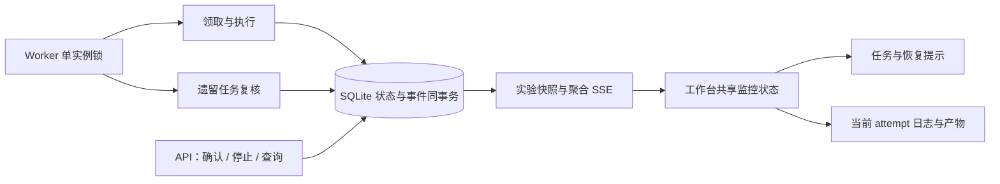

# Worker 重启恢复与多日期实验监控技术方案

日期：2026-11-12。状态：已完成代码实施、独立审查、mock进程故障验证和合成浏览器验收；尚未部署或执行真实GREAT。最新结果见[实施记录](../../validation/2026-11-12-worker-recovery-and-monitor.md)。下文保留批准时的设计与验收目标。

本方案依据当前工作区（包含未提交实现）和用户指定的两项问题编写。推荐保持 Windows 本机、一个 Solver Worker、FastAPI、SQLite WAL 和现有 React 工作台；不引入 Redis、Celery、WebSocket 或新的任务执行授权方式。下面的周期、容量和性能数字是建议验收值，不是已测结果。

## 1. 结论与推荐路线

两项问题分别发生在执行管理和状态分发层：

- 恢复侧缺少持续的遗留进程复核，只有 PID，没有足够的进程身份及恢复状态；退出后不能释放配额。
- 监控侧按日任务建立永久 SSE，断线立即重连；缺少实验统一游标和一致快照，状态与产物也没有统一更新机制。

推荐采用“单 Worker 实例锁 + 持续恢复服务”和“事务内实验事件日志 + 每页面一个实验 SSE”。恢复服务产生的状态变化进入同一事件日志，由工作台统一消费。



## 2. 问题一：Worker 重启后的任务恢复

### 2.1 已确认的触发链路

1. Worker 领取任务后将 task/attempt 标为 `running`，再启动 GREAT 并记录 PID。
2. Worker 异常退出，但 GREAT 仍运行。
3. 新 Worker 仅在 `cli.py:219` 调用一次 `recover_stale_tasks(set(psutil.pids()))`。
4. `repositories.py:328` 发现旧 PID 存在，仅发布 `recovery_blocked` 并保留 `running`。
5. 新 Worker 后续不再观察该旧进程；旧进程结束后，task/attempt 仍是 `running`。
6. `claim_next()` 按 `running` 计算全局和实验配额，因此该槽位不会释放；现有重试仅允许 `failed/interrupted`。

停止也存在同一边界：`ProcessRunner.cancel()` 只识别当前进程内 `_active`，无法控制重启前的 GREAT。API 虽能写取消请求，遗留任务没有对应观察者消费它。

### 2.2 不能直接采用的简化修复

| 做法 | 未解决的问题 |
| --- | --- |
| 把现有 recover 函数放进定时循环 | 只有 PID，无法识别 PID 重用；也没有 Worker 所有权保护，可能干扰健康执行。 |
| 重启后全部改为 interrupted | 旧 GREAT 可能还在运行；释放槽位后会超出实际并发，并可能让同一日期重复解算。 |
| 只凭输出文件存在认定 succeeded | 原进程可能失败且留下部分或旧文件；缺少可信退出结论。 |
| 心跳超时即释放槽位 | Worker 心跳超时不能证明 GREAT 已经结束。 |

### 2.3 推荐：单实例边界与进程身份

**Worker 实例边界。** CLI 在恢复或领取任务之前，取得与规范化数据库路径对应的 Windows OS 文件锁，并持有至 Worker 退出。第二个 Solver Worker 启动失败且给出已有实例提示。锁不能仅依赖文件存在或 PID 文本；进程退出时 OS 自动释放。API 构造服务不取得 Solver Worker 锁，也不运行恢复循环。

这一选择沿用当前 `start.ps1` 启动一个 Worker 的部署方式。保留数据库原子配额和竞争测试；本批不提供多 Worker 故障接管。将来支持多 Worker 时，再设计实例租约与防止旧实例写回的版本令牌，不能只删除单实例锁。

每次 Worker 启动生成 `worker_session_id` UUID，区别于目前的 `worker-1` 槽位名。锁句柄不能被 GREAT 继承，否则 Worker 已退出而 GREAT 继续持锁会阻止恢复。task/attempt 的生命周期更新必须携带该所有权标识，并检查当前 `active_attempt_id`；OS 锁属于执行入口，不能在 API 的 Worker 构造函数中取得。

**进程身份。** 新 attempt 至少持久保存：

| 字段 | 作用 |
| --- | --- |
| `owner_session_id` | 标识执行或恢复观察的 Worker 实例。 |
| `launch_phase` | `reserved / spawning / started / exited`，区分未启动和启动信息丢失。 |
| `pid`、`process_created_at` | 识别具体 OS 进程；创建时间不能用 attempt 的 started_at 替代。 |
| `executable_path`、`command_sha256` | 与已批准的绝对程序路径、准确参数数组及 attempt 独立 XML 路径核对。 |
| `recovery_state`、`recovery_reason`、`last_checked_at` | 表达正常、观察遗留进程、身份不明、需处理等辅助状态。 |
| `version` | 非空整数，数据库默认0；每次生命周期或恢复状态变化递增，用于条件更新。 |

上述所有权、启动与恢复字段以 active attempt 为权威；task 的 worker_id 可以保留实例/槽位显示信息，但不独立形成另一套执行权。恢复接管观察时，在短事务中按旧 owner/version 条件切换到新 owner，并进入 observing/blocked；旧实例回调即使迟到，也不能再提交终态。

Windows 适配器使用进程句柄读取创建时间，建议保存 FILETIME 整数；`psutil` 读取命令行并辅助发现候选。终止操作使用已经完成身份核对的同一 OS 进程句柄，避免“核对 PID 后 PID 被重用”的竞争。

程序与命令信息来自现有批准记录，恢复接口不接受浏览器传入的任意 PID、路径或命令作为授权依据。核对的是正在运行的进程身份，不因原输入文件运行后改变而自动启动其他程序。

### 2.4 独立恢复循环与状态规则

在 Worker 生命周期内独立运行 `RecoveryService`，建议每 2 秒复核一次。不能把复核放在当前批次 `gather()` 之后，否则一个长任务会阻止其他遗留任务恢复。OS 查询在线程中执行，数据库事务只用于短暂的条件更新，不跨越进程等待、文件扫描或 sleep。

保留现有任务状态枚举；`recovery_state` 是辅助状态，不新增一个未经配额适配的任务终态。

| 观察结果 | task/attempt 状态及动作 | 配额 |
| --- | --- | --- |
| 身份匹配的旧 GREAT 仍运行 | 保持 running；设置 observing，持续观察，前端显示“遗留进程仍运行”。 | 继续占用。 |
| 已可靠确认原进程结束 | 原子改为 interrupted，记录 `worker_lost`；保留原日志和输出，不自动执行或自动认定成功。 | 提交终态时释放。 |
| PID 已被其他创建时间的进程重用 | 不操作新进程；有完整旧身份时可确认原进程已结束，转 interrupted。 | 提交终态时释放。 |
| AccessDenied、旧记录缺身份、候选冲突 | 保持 running，设置 blocked 和明确原因；不得把“查不到”当作退出。 | 继续占用。 |
| 收到停止请求且旧进程身份完整匹配 | 使用同一已验证进程句柄终止；确认退出后改 cancelled，记录审计事件。 | 确认退出后释放。 |
| 停止请求遇到身份不明或权限不足 | 保留阻塞状态，说明原因；不按进程名批量终止。 | 继续占用。 |

本批采用保守恢复语义：遗留任务自然退出后记为 interrupted，`exit_code` 无可靠来源时为空。即使输出齐全也不自动记成功。若以后需要“Worker 崩溃后仍保留成功结果”，另增持久执行监督器和可信完成回执；不能用日志末行替代退出证据。Windows 对已附着进程可以读取退出信息，但本批不依赖所有故障窗口都能附着。

恢复状态写入、task/attempt 终态、恢复审计事件和实验监控事件必须同一 SQLite 事务提交。条件更新须核对 `task.status=running`、原 active attempt、owner_session_id 及预期恢复版本；重复复核或迟到回调只能有一个成功。健康的当前实例任务不进入遗留扫描。

### 2.5 启动窗口与历史记录

需要覆盖 Worker 在 `create_subprocess_exec()` 与 `record_pid()` 之间退出的窗口：

- 启动前先持久化 `launch_phase=spawning`、批准命令指纹和唯一 attempt XML 路径；启动后立即保存完整身份。
- `reserved` 阶段严格禁止 spawn；持锁的新 Worker 确认旧实例退出后，可把仍处于该阶段的旧 attempt 收敛为 interrupted。
- 新 Worker 遇到 `spawning + pid为空`，先按已批准的准确程序和独立 XML 参数查找候选，不得直接释放槽位。唯一候选可进入只读观察；停止前仍须形成可靠身份，不能仅凭名称终止。
- 旧实例已退出、候选发现范围完整且可靠、确认不存在匹配进程时，可把该启动收敛为 interrupted；扫描受限或证据不完整则保持 launch_unknown。重新检测必须实际重新探测，不能永久复用第一次 PID 快照。
- 权限不足、多个候选或证据不足，进入 blocked，展示“启动信息不完整”；人工排查或恢复身份后再检测。有限度的自动发现不能承诺覆盖无法访问的 OS 信息。
- 启动回调或数据库记录失败时，运行器要清理自己已创建并持有句柄的进程，并保留启动失败证据；不得因回调抛异常留下无人管理的进程。
- 历史 attempt 的新增身份字段为空，不伪造创建时间。明确已退出的历史任务可以保守中断；仍活动且身份无法充分验证的记录维持阻塞，提供重新检测和问题说明。

本方案按当前直接执行一个 GREAT 进程的方式设计。实施前用 mock 和程序行为确认没有继续存活的派生计算进程；若存在，配额释放和停止必须覆盖受控进程集合，不能只看父 PID。Windows 的 terminate 与 kill 通常对应同类强制终止，等待5秒不应被描述为已经实现“优雅停止”。

### 2.6 API 与用户可操作入口

建议增加：

- `GET /api/v1/tasks/{task_id}/recovery`：当前恢复状态、原因、最近检查、已识别身份的安全摘要，以及可执行动作。
- `POST /api/v1/tasks/{task_id}/recovery/recheck`：带 expected_attempt_id 和幂等 request_id，仅提交重新检测请求，不运行 GREAT。
- 停止继续复用现有实验停止请求；界面可对可识别遗留任务提供单任务停止入口，后端同样只写持久取消请求，由 Worker 执行身份核验和终止。

不提供“无视旧进程强制释放槽位并重跑”按钮。恢复为 interrupted 后，重试仍是新 attempt → XML 预览 → 用户明确确认；自动恢复不复用旧批准启动新进程。

## 3. 问题二：多日期任务的监控连接

### 3.1 已确认的根因及风险边界

- `RunDashboard.tsx:30–49` 为全部 task ID 建流，包括终态任务；34 天实验会尝试建立 34 个流。
- `api/events.py:26–43` 每条流每 250ms 查询一次，空闲也不关闭。若 N 条流都已建立，查询频率约为 `4N 次/秒`；这是代码推导，不是实测吞吐。
- 断线后 `setTimeout(..., 0)` 立即重连，服务不可用时可能连续失败重试。
- 当前先读任务快照，再让每个任务从 sequence=0 重放，会短暂把当前状态回写为旧状态。
- `TaskEventModel.id` 是 UUID，sequence 只在 task 内有序；不能把多个任务的 sequence 直接拼成实验游标，也不能把 UUID 当递增整数。
- 新任务创建和重试 pending 路径尚未发对应事件；分析文件登记和 analysis_completed 也不是同一事务。
- SSE 客户端只按 LF 空行拆分，缺少 CRLF 等边界处理和业务 payload 校验；图片页只在任务/attempt/模式变化时加载。

浏览器在 HTTP/1 场景存在较小的同源连接额度，多个永久流可能挤占普通 API。这里确认的是架构风险，尚未在本项目完成多任务浏览器压测；后端当前发 LF，也没有证据表明 CRLF 已造成线上故障。

### 3.2 方案比较

| 方案 | 收益与限制 |
| --- | --- |
| 原任务流增加退避，终态关闭 | 改动最小，但活动日任务多时仍占用多条连接，产物和恢复更新也没有统一游标。适合临时止血。 |
| 实验快照定时轮询 | 简单且无长连接问题，可作为失败降级；仍有重复全量查询和固定延迟。 |
| **实验聚合 SSE + 一致快照** | 推荐。每个页面当前实验一条流，支持回放、恢复事件和按事件刷新。沿用现有技术栈。 |
| WebSocket / Redis PubSub | 本机现阶段收益不足；单独使用内存或 PubSub 也不能解决持久回放与事务一致性。 |

### 3.3 事务内实验事件日志

新增 `experiment_events`，保留原 `task_events` 与旧 task SSE：

| 字段 | 规则 |
| --- | --- |
| `id` | SQLite `INTEGER PRIMARY KEY AUTOINCREMENT`，作为可持久回放的全局递增位置。 |
| `experiment_id` | 必填；建立 `(experiment_id, id)` 索引。 |
| `task_id`、`attempt_id` | 适用时保存。 |
| `task_event_id` | 关联旧事件时唯一，避免重复映射；实验级事件允许为空。 |
| `schema_version`、`kind`、`payload_json`、`created_at` | 产品事件协议和受控业务数据。 |

另持久保存当前事件日志的 `epoch` UUID，首次迁移生成；数据库恢复维护命令负责旋转 epoch，并要求页面重新快照。epoch 不随正常 API 重启改变。

全局 id 在单个实验中可以跳号；客户端不能要求下一个 id 必须等于上一个加一。SQLite AUTOINCREMENT 的用途是避免清理旧事件后复用已提交位置，并非要求编号连续。

所有生产者统一通过仓储追加事件：状态变化、旧 TaskEvent 和新 ExperimentEvent 同事务提交。确认创建任务、重试入队、领取、开始执行、停止请求、恢复状态、终态、分析开始/完成/失败/跳过、产物版本变化均须覆盖。聊天确认复用调用方事务时也必须使用同一个 session，不能提前独立提交事件。

重试入队尚未创建新的 attempt UUID，此时事件的 attempt_id 为空并提供 next_attempt_number；不能把旧 active_attempt_id 误标为下一次执行。claim 创建新 attempt 后才发出对应的真实 attempt_id。

结果登记与 `analysis_status/artifact_version` 的更新也应封装为同事务方法，解决“文件登记成功、事件未保存”的空隙。图像字节仍在原 attempt 目录，事件仅通知元数据变化，不通过 SSE 传日志或 PNG。

为一致快照在 attempt 上持久化 `analysis_status`（unknown/not_started/running/completed/failed/skipped）及 `artifact_version` 非负整数。历史记录迁移为 unknown，不凭图片存在推断科研分析成功；新 attempt 从 not_started/0 开始。每次结果登记更新或后处理状态变化，与对应事件同事务提交。

迁移不修改历史 TaskEvent 的 UUID/sequence。新日志从切换后开始完整记录；首次快照包含全部现有任务，历史事件查询仍可走旧接口。不伪造迁移前的实验事件顺序。

### 3.4 新接口与快照边界

- `GET /api/v1/experiments/{experiment_id}/monitor`：返回任务列表、active attempt、恢复摘要、后处理状态、artifact_version 及 cursor。
- `GET /api/v1/experiments/{experiment_id}/events`：使用 `Last-Event-ID` 订阅 cursor 之后的增量。

快照需要显式启动 SQLite **只读事务**，在同一连接和同一快照内读取事件高水位及批量任务/attempt/分析元数据，然后完全物化结果、结束事务。现有按 task 逐个另开 session 的 `list_tasks()` 不可直接用于此一致快照。禁止为了读快照使用 BEGIN IMMEDIATE，禁止跨 SSE yield 保持数据库事务。

前端先应用快照及 cursor，再连接 SSE。快照结束到建立连接之间的事件已持久化，可按 cursor 重放，因此不会丢失该窗口内的变化。

建议 wire 格式：

```text
id: v1:<epoch_uuid>:<experiment_uuid>:4812
event: task.status
data: {"schema_version":1,"event_id":"v1:<epoch_uuid>:<experiment_uuid>:4812","experiment_id":"...","task_id":"...","attempt_id":"...","type":"task.status","data":{"status":"interrupted","reason":"worker_lost"}}

```

cursor 绑定实验、epoch 与协议版本；SSE 请求必须携带快照返回的 cursor，缺失或不合法返回明确 400。游标超出当前日志高水位、早于保留边界，或数据库恢复后 epoch 不兼容，返回 `409 cursor_reset_required`，客户端重新读取快照。上线初期不清理新事件；引入清理时同步保存每实验保留水位。数据库恢复必须走停止服务、恢复同点备份、旋转epoch、重启服务的维护流程；不能承诺识别绕过维护流程的任意数据库替换。

cursor 的数字位置以十进制字符串传输，校验格式和范围后用 BigInt 比较；不转换为 JavaScript Number，不按字符串字典顺序比较64位ID。cursor 不能单独持久保存后用于一个空的前端 store：刷新页面先重新快照；同一 store 生命周期内才携带已应用的 cursor 续传。

重复事件以完整 event_id 去重，同流中仅保留最后已应用位置即可，避免无界 seen 集合。已知版本中未知事件类型可忽略并推进游标；不支持的 schema_version 停止订阅并提示升级。格式损坏、无法校验的重要事件不悄悄跳过，先重取快照恢复状态。客户端只在 reducer 应用或明确忽略后更新已消费游标。

### 3.5 单连接消费与重连策略

在工作台层建立 `useExperimentMonitor(experimentId)` 或同等共享 store，任务板、图片页和恢复提示复用同一连接；切中间 Tab 不额外建流，切实验/卸载时 abort 旧流并取消全部定时器，迟到响应用 experiment/generation 隔离。

- 每页当前实验最多 1 条监控 SSE，任务数不影响连接数；多个浏览器标签页各有一条，不承诺任意标签页数量无连接限制。
- 建议退避基准 `0.5 / 1 / 2 / 4 / 8 / 15 秒`，附 0.8–1.2 倍抖动；连接稳定 10 秒后再重置失败次数，避免“刚连接就断开”持续回到 0.5 秒。
- 网络断线、5xx 退避重连；429 尊重 Retry-After 并封顶；400/404 等明确不可恢复错误停止自动重试并显示原因；409 cursor_reset_required 重读快照。
- 服务端空闲时建议每 15 秒发送注释 heartbeat；客户端连续约 45 秒无数据/心跳则主动中止并按退避恢复。数值需纳入可控计时测试。
- 解析器按 UTF-8 增量和逐行状态机处理 LF、CRLF、CR、多行 data、注释和跨 chunk 边界，遵守 SSE 规范；缓冲大小与单事件大小设上限，超限重新同步快照。
- 页面断网时暂停定时重试；online 后恢复，且仍保留当前 cursor 和失败预算。

本批保持可见工作台的聚合流，包括实验全部完成后的空闲状态，以便接收后续手工分析和重试事件；连接总数已降为一条。不因“solver 全部终态”就宣布整个实验永远不会再有事件。

### 3.6 服务端查询、后处理和日志

第一版每条实验 SSE 每 500ms 批量查该实验的新事件；任务从1个增加到100个，查询频率保持不变。每页面只存在一条流，因此两个标签页约为每秒4次空闲事件查询，而不再为每个日期独立查库。先采用这个简单模型；若以后大量标签页需要进一步优化，再引入应用级共享 tailer 和有界扇出队列，不能把进程内通知当作数据库回放的替代。

500ms 是建议初值；每批建议限制 200 条，有积压时立即继续取下一批；慢连接每次最多持有一批已物化事件，不设无界内存待发列表。后台轮询使用线程中的短数据库操作，不阻塞 FastAPI 事件循环。

事件更新分工：

- task.status / recovery.changed：更新计数、任务行和恢复提示。
- task.created / attempt.queued / attempt.started：更新任务及 attempt 元数据，保证另一个页面发起的重试也可见。
- analysis.completed / artifacts.changed：使相关 attempt 的结果缓存失效并重新读取；当前图片页自动刷新，保持用户手选的历史 attempt。
- analysis.failed / skipped：展示独立后处理状态，解算 succeeded 不等同于图片已生成。
- 日志继续只为当前选中的运行 attempt 做受控轮询；首批保留现有 2.5 秒节奏，不把全部日志塞进事件流。

前端成功后处理若使用同名图片 URL，需要让 artifact_version 进入图片请求的缓存标识，或由文件接口设置相应缓存策略，避免重算后继续显示旧 PNG。

## 4. 改动范围

| 层 | 主要文件或新增模块 | 工作内容 |
| --- | --- | --- |
| 数据迁移 | 下一个可用 Alembic revision | 恢复身份字段、Worker session/恢复元数据、实验事件表与索引；迁移编号须以实施时最新 head 为准。 |
| 运行层 | cli.py、worker.py、process_runner.py；新增 process_identity.py、recovery_service.py | 单实例锁、实例身份、独立复核、受控遗留停止、启动失败清理。 |
| 仓储 | db/models.py、db/repositories.py | 所有权条件更新、终态与配额原子收敛、事务事件写入、一致监控快照。 |
| 执行与分析服务 | execution_service.py、result_analysis_service.py | 补任务创建/重试事件，后处理状态与产物登记同事务。 |
| API | experiments.py、events.py、tasks.py、dependencies.py | 新快照/聚合流/恢复查询接口；原 task SSE 保留兼容。 |
| 前端 | api/client.ts、api/types.ts、RunDashboard.tsx、ArtifactBrowser.tsx；新增共享监控 hook/store | 单连接、可靠解析/退避、事件失效刷新、恢复和分析状态。 |

## 5. 验收与故障注入

### 5.1 恢复用例

1. 用可控 mock solver 启动任务，单独结束其 Worker；保留 solver，重启 Worker，任务保持 running 且显示 observing，不创建第二个 solver。
2. 旧 solver 之后退出：建议 5 秒内 task/attempt 收敛为 interrupted，配额释放且只出现一次终态事件；不会自动重跑。
3. 从另一个 API 进程请求停止：身份匹配的遗留 solver 被终止，退出后才变 cancelled；其他 Python/GREAT 进程不受影响。
4. PID 重用、AccessDenied、缺创建时间、多候选、spawning+无PID分别验证：不会误杀或错误释放配额，提示与允许动作准确。
5. 第二个 Worker 在领取前被 OS 锁拒绝；API 重启不触发任务恢复。
6. 当前健康长任务、恢复扫描和取消并行时，旧 owner/旧 attempt 更新被拒绝；全局/实验配额仍成立。
7. 在领取、启动前、启动后未记PID、已记身份、solver退出未写终态等位置注入崩溃，并检查批准/日志/结果保留。
8. 恢复后的重试必须重新生成下一 attempt XML 并明确确认，旧批准不会产生额外执行。

### 5.2 监控用例

1. 1/34/100 个任务分别验证：一个页面仅一条实验监控流；终态任务不产生额外日流。
2. 实际 Chromium/Edge HTTP/1 浏览器测试：100任务、2标签页下，普通任务查询/日志/无模型健康接口保持可用；不能仅用 jsdom 模拟声称通过。
3. 快照读取、提交新状态、建立 SSE 交错：重放不丢事件，任务不会回退到早期历史状态；两个实验事件交错不会混入对方数据。
4. 断网/服务停止/5xx/429/反复短连接：计时断言退避和 Retry-After，停止重连后无残留定时器；恢复携带已消费 Last-Event-ID。
5. 拆分 UTF-8、LF/CRLF/CR、多行data、心跳、坏JSON、未知类型、重复事件、非法/过旧/超前游标分别覆盖。
6. 分析完成时提前打开的图片自动更新；失败/跳过有明确状态；重算同一路径不显示旧图；历史 attempt 选择不被新 attempt 抢走。
7. 状态事务回滚时新旧事件均不可见；产物登记/分析事件一致；API/Worker重启后仍能回放。
8. 测数据库查询计划与每连接批次缓冲上界：活跃日任务从1增至100不会把监控轮询次数放大100倍；慢消费者断开后可重取快照恢复。

建议在本机合成压力下将状态提交到可见更新 P95 定为 2 秒以内、普通本地查询 P95 定为 1 秒以内；先记录基线与负载，再确认阈值，不能把建议指标当作现有性能。

## 6. 实施顺序、交付与回退

1. 先建立可控 mock 故障场景及现有行为基线，记录 SQLite/浏览器当前连接和查询情况。
2. 加入迁移、单实例边界和身份/条件更新；再加入独立恢复循环和受控恢复入口。
3. 将状态写入与实验事件同事务，补齐创建、重试和后处理生产者，再实现快照与 SSE。
4. 前端切换共享监控、退避与产物刷新，完成真实浏览器多日任务和 Worker 故障注入。
5. 通过相关回归、类型检查、构建及专项评审后，再安排本地服务切换；本技术方案不执行切换。

建议工作量为 6–9 人日：恢复约2–3、事件和前端约3–4、联合故障与浏览器验收约1–2；这是粗估，Windows进程身份适配和现有并行改动会影响实际工作量。

迁移采用增量表/可空身份字段以及明确的服务器默认值，部署前同点备份数据库和runs。现有 create_all 不会给旧表补列，必须运行实际 Alembic 升级并在启动时检查兼容版本。启用新监控前，API、Worker、CLI后处理等全部状态写入进程都要升级；不能在旧 Worker 不写实验事件的混合版本中声称增量完整。

保留旧 task SSE，但聚合链路故障时优先降级为低频实验快照轮询，不能重新同时打开100条旧日流。回退不删新表或重写历史 attempt；先确认任务空闲或按新协议完成恢复交接，不允许在活跃任务上直接退回不识别新所有权/恢复状态的旧 Worker，也不把数据库交给两个 Worker 同时管理。

## 7. 依据与未实施边界

源码定位以本方案编写时工作区为准：cli.py:219、repositories.py:137/311/464/535、process_runner.py:34/56、worker.py:51/67/78、RunDashboard.tsx:29、api/events.py:26、api/client.ts:105、db/models.py:128、execution_service.py:151/161。实施前需核对并行任务造成的行号或迁移 head 变化。

规范依据：

- [MDN：SSE 使用及 HTTP/1 同源连接限制](https://developer.mozilla.org/en-US/docs/Web/API/Server-sent_events/Using_server-sent_events)
- [WHATWG：SSE 解析、Last-Event-ID 与重连语义](https://html.spec.whatwg.org/multipage/server-sent-events.html)
- [Microsoft：进程句柄与 PID 的有效期](https://learn.microsoft.com/en-us/windows/win32/procthread/process-handles-and-identifiers)
- [psutil：进程身份、PID 重用和 Windows wait](https://psutil.io/api/)
- [SQLite：事务与 BEGIN IMMEDIATE](https://www.sqlite.org/lang_transaction.html)
- [SQLAlchemy：SQLite legacy 模式下 SELECT 的事务边界](https://docs.sqlalchemy.org/en/20/dialects/sqlite.html#legacy-transaction-mode-with-the-sqlite3-driver)
- [SQLite：AUTOINCREMENT 的递增和不复用语义](https://www.sqlite.org/autoinc.html)

方案编写阶段只进行了源码与规范核对；后续已按批准内容实施，测试、故障验证及浏览器结果以本页顶部链接的实施记录为准。未运行真实GREAT、调用真实模型、修改正式数据库或切换正式服务；合成压力数据不代表真实科研精度验收。
