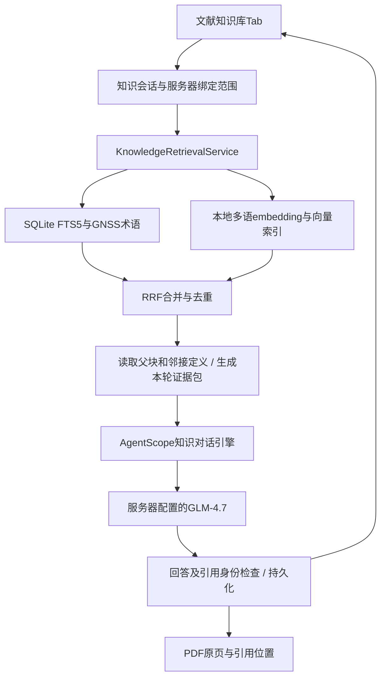

# 文献知识库页面 Tab 与有来源的模型对话方案

日期：2026-11-13。交付：两张页面预览、可切换的静态原型和本技术方案。本轮没有修改产品入口、迁移正式库、下载模型或调用真实模型。预览中的回答是设计示例，源表来自用户提供的Tao论文第12页。

## 1. 页面目标和当前基础

在现有顶栏增加真正的“文献知识库”页面Tab，与“实验工作台”并列。知识页提供“文献对话”和“文档与解析”两个视图。用户上传论文、查看解析质量、选择本轮文献范围、向模型提问，再从回答中的引用回到原文核对。

延续现有Ant Design、蓝白配色、字体和紧凑科研工作台布局。桌面三栏为“文献范围 → 对话/解析 → 原文核对”。窄屏把来源和文献列表收为按需展开的面板，保留输入区和引用访问；这里的面板收纳不改变顶层独立页面Tab。

已有基础可直接复用：8张knowledge表、SHA256原件归档、持久化上传/解析任务、不可变解析版本、FTS5、切片/位置/质量标记、停用/重解析；已有AgentScope 2.0.11、GLM模型配置、持久化会话及幂等run、Markdown显示和SSE解析器。

当前缺口是完整知识页、知识会话绑定、embedding/混合检索、逐轮证据/引用持久化和原文高亮。旧“知识库”入口仍是Drawer，`knowledge_search/paper_analysis_ready`仍关闭；当前模型runtime为`stream=False`。不能把现有普通聊天正确回答当作知识库RAG成功。

此前只读小样本中，11道内容题中文Page-hit@5为5/11，对应英文为11/11。这只证明需要改善中文检索，不能当作证据召回率、模型准确率或发布标准。[现有基线](../../../output/knowledge/tao-2025-product-acceptance/retrieval-baseline-20261113.json)

## 2. 页面预览和交互

预览文件：

- `output/knowledge-chat-design-20261113/knowledge-chat-preview.png`：文献对话、模型选择、来源核对。
- `output/knowledge-chat-design-20261113/knowledge-parsing-preview.png`：上传、解析状态、内容与质量检视。
- 同目录`preview.html`：切换两种设计视图；按钮与回答均为布局示例，不执行上传或模型请求。
- 同目录SVG及`.codex_work/knowledge-chat-design-20261113/render_previews.mjs`：可修改的原生设计源；PNG采用CPU渲染，不是已部署页面的浏览器截图。

左栏固定库和勾选文献，并显示“仅所选文献/整个库”的实际范围；空选择不能偷偷解释为整个库。上传后分别显示接收、解析、建立索引和可检索状态，保留失败原因、重解析及原件入口。未来语义索引未就绪时显示当前只支持关键词检索，不能用一个绿色“完成”掩盖状态差异。

中栏“文献对话”包含模型选择、问题、回答、结构化引用卡和输入框。点[S1]会选择右侧来源；回答中的科学数字必须有支持证据，文献未给出时说明不足。“文档与解析”复用已有API，按页面、段落、表格、公式、切片查看原文与派生内容，失败重解析仍可查看此前版本。

右栏显示文献标题、版本对应的来源、物理页与印刷页标签、原页区域、引用片段和质量提示。Table3原图用于说明核对过程；不能据此声称通用解析器已经自动正确识别所有表格。正式功能需用结构化解析结果或人工核验记录确认元素定位。

模型下拉只显示服务器登记的profile与是否已配置，不显示API Key。选择云端GLM时明确说明问题和选用证据会发送给它。模型切换只影响后续请求，已完成回答保留原模型、文献版本和引用。

路由建议为`?workspace=knowledge&base=<id>&chat=<id>`；旧实验参数保持兼容。顶层workspace独立于现有实验内部的plan/run/review/plots，避免把全局知识页塞进`WorkbenchView`。切换Tab保留草稿和会话，模型结果按conversation_id/request_id绑定，迟到结果不能覆盖另一页。

## 3. 参考已有项目的实际实现

| 案例 | 官方实现可确认的能力 | 本项目借鉴方式 |
|---|---|---|
| [Docling](https://github.com/docling-project/docling) | 层级文档、表格/图片、page/bbox provenance；结构与tokenizer结合的切片 | 保留结构化JSON和坐标，改进当前文字基线；解析器独立于聊天 |
| [kotaemon FullQAPipeline](https://github.com/Cinnamon/kotaemon/blob/main/libs/ktem/ktem/reasoning/simple.py) | 检索、准备证据、生成、引用显示分层；有文本/向量检索及来源预览 | 借鉴三栏工作流和evidence pipeline，引用主键使用本系统不可变chunk/version |
| [Dify检索节点](https://github.com/langgenius/dify/blob/main/api/core/workflow/nodes/knowledge_retrieval/knowledge_retrieval_node.py) | 检索节点输出内容与来源元数据，下游LLM显式使用检索上下文 | 把Retriever、Evidence、ModelProvider分开，保留可单独运行的检索测试 |

这是对公开可运行实现与源码的借鉴，本轮未在本机启动整套案例。继续扩展当前FastAPI/SQLite/AgentScope/React，不迁移到这些项目的应用/数据库体系，不照抄可能丢失bbox的loader或未经许可的源码。精确源码链接与取舍见[案例核查](../../research/2026-11-13-knowledge-chat-cases.md)。

## 4. 接入链路与模型职责



上传解析仍为独立持久任务，不在提问时重读整篇PDF，不占用GREAT Solver Worker。模型提问不跨数据库事务等待；取证、外部生成、提交结果分别处理。

| 组件 | 建议选择 | 当前状态 |
|---|---|---|
| 回答模型 | 复用现有GLM-4.7与AgentScope 2.0.11 adapter，服务器持有凭据 | 现有咨询模型已配置，文献回答待接入 |
| Embedding | 先评测本地multilingual-e5-small等较小多语模型，按硬件和GNSS样本冻结版本 | 尚未安装/验收；聊天模型不能直接代替embedding |
| 词法 | 保留FTS5及GNSS别名；需要中文分词时显式迁移/重建索引 | 已有基线 |
| 向量索引 | 起步候选Qdrant local，单一KnowledgeService拥有客户端；规模测试决定是否server | 尚未实现 |
| Reranker | 第一版可关闭；有可测收益再启用本地交叉编码器 | 尚未实现，不默认逐块调用远程GLM |

E5-small官方模型卡说明384维、输入最多512 tokens，并要求query/passage使用对应前缀。因此现有700“估算token”切片不能直接全部送入并静默截断。需按真实embedding tokenizer重切检索子块，给标题/章节及前缀留空间；保留父块和完整表格供read_evidence扩展。重切产生新generation，不篡改旧引用。[官方模型卡](https://huggingface.co/intfloat/multilingual-e5-small)、[Docling tokenizer-aware chunking](https://docling-project.github.io/docling/concepts/chunking/)

检索子块与原解析chunk分开：新增`knowledge_index_segments`记录`id/generation_id/parent_chunk_id/ordinal/source_spans/embedding_text_hash`，其中source_spans指向不可变父chunk中的起止字符，计量单位固定为Unicode code point，支持多段表头/正文。Qdrant point保存segment ID与同样的父身份，SQLite保留映射；检索融合时先按父chunk去重，再根据命中子范围和父块生成证据。标题/章节等embedding前缀与原文范围分开记录，不伪装成连续原文。若重叠或整表扩展产生多段，保存完整span数组和可靠bbox，不根据字符偏移伪造词级坐标。

本地模型权重路径、revision、维度、tokenizer、切片规则都写入索引指纹，首次模型下载和资源测试单独安排，不在用户上传时隐式触发。小模型也需实测内存和冷/热延迟，不依据公开榜单承诺本机效果。

## 5. 中文检索和证据准备

每轮先固定服务器范围快照：base、文档ID、可访问版本、模型profile和检索配置。FTS与dense均使用这个范围；合并后再次根据SQLite验证enabled/版本状态。知识工具不能凭模型传入的其他库ID、文件路径或chunk UUID扩大范围。

起始实验参数为FTS20＋dense20，按version/chunk去重，RRF融合后取候选20，最终按上下文预算选择6–8个证据块。参数只是调参起点；不把BM25原值与cosine直接相加。相邻重复块合并，跨页定义、多层表头/单位、公式附近解释通过父块扩展补齐。

整轮预算不是只设输出max_tokens。首版配置建议：当前问题最多2000字符、历史最多6000字符、最终证据最多12000字符且不超过6000输入tokens、受控系统/工具元数据最多6000字符，整轮序列化输入硬限26000字符；有目标模型计数器时再执行整轮12000输入tokens上限。输出沿用2048 tokens预留，并须满足该profile经验证的上下文总窗口。没有真实计数器时明确记录estimated，先用上述字符硬限并实测该profile最大体积请求，不能把估算当真实tokens；验证不足的profile不开启长上下文问答。

每次父块扩展和工具追加都重新计入同一预算，包含来源metadata和重复内容，不允许工具结果绕过上限。超预算时先删旧历史，再缩减低排名/重复证据与可选邻接内容；保留当前问题和必要表头/定义，不在公式或数值行中间静默截断。仍容纳不了充分证据时要求缩小问题范围。记录实际发出的messages和证据包尺寸/计数模式，才能复现生成结果。

保留原问题查询通道和GNSS缩写、波段、编号、单位及数值。需要中文改写/英文检索词时作为辅助分支，不能把参考答案中的年份或数值塞进查询以获得虚高命中率。改写若调用模型，计入现有物理请求预算；没有改写时可以一次生成调用完成回答。

每轮记录原始/改写查询、过滤范围、两路候选与排名、融合结果、最终证据、索引指纹和耗时。解析质量差、证据不全或文献仅在图内给数时，回答应说明限制并提供原页；第一版文本RAG不能宣称已经理解曲线和公式图像。

## 6. 知识会话的权限与历史

新增`KnowledgeConversationService`和窄的`KnowledgeConversationEngine`，复用当前模型构建、预算、错误脱敏和ConversationRepository的持久化/幂等能力。知识会话显式绑定`scope_kind=knowledge`，数据库scope可用`knowledge:<UUID>`；不复用`experiment_id=None`来判断权限。

原因是当前ConversationService在context为None时提供create_experiment能力。知识页只注册`search_knowledge(query)`与`read_evidence(evidence_ids)`，所有ID均由本轮服务器证据仓校验；不注册实验创建、修改计划、确认执行、文件路径或shell工具。文献中的文字作为资料，不能改变这些工具权限。

新引擎不直接恢复含旧检索文本的opaque SDK state。每轮从持久消息构造经过来源状态核验的历史；库/文档集变化会失效旧工具结果和相关SDK缓存。旧助手回答若引用了已停用/越范围来源，其正文和相关工具输出不得再次作为背景发送给模型。历史页面可保留原回答和“来源不可用”状态，不能悄悄换成新片段。

每个run固定来源版本。文档中途重解析时不混用新旧块；若仍可访问，可完成对固定旧版本的引用并保留版本身份。文档停用或范围撤销后，停止后续读取并在提交回答前再次核验；不能承诺已经发出的远程请求可撤回。

沿用90秒回合预算、最多4个物理模型请求和6次工具调用作为首版起点，单独记录检索/生成耗时。先复用真实生命周期事件“检索/生成/完成/失败”；当前runtime的stream=False不能冒充token流。需要逐token输出时新增并实测SDK流式adapter，处理中断、断线和恢复，最终以持久化完成消息为准。

## 7. 引用契约与原页定位

服务端先将本轮证据编号为S1、S2等，再把正文和编号交给模型。模型只能引用该集合，文档名、页码和版本由后端来源记录生成，不要求模型猜测。

```json
{
  "type": "citation",
  "source_id": "S1",
  "conversation_id": "<knowledge-conversation-uuid>",
  "run_id": "<owned-run-uuid>",
  "message_id": "<answer-message-uuid>",
  "document_id": "<document-uuid>",
  "version_id": "<immutable-version-uuid>",
  "chunk_id": "<immutable-chunk-uuid>",
  "source_sha256": "<original-file-hash>",
  "evidence_text": "<本轮实际传给模型的摘录原文>",
  "evidence_text_sha256": "<text-hash>",
  "source_spans": [{"chunk_id": "<immutable-parent-chunk-uuid>", "start": 0, "end": 120, "offset_unit": "unicode_codepoint"}],
  "locations": [{"page_index": 11, "page_label": "12", "bbox": [50, 624, 546, 718]}]
}
```

这里的坐标是Tao示例区域，身份/摘录为契约占位符，字符偏移仅为类型示意；实际span由已存原文计算。跨页/多段引用保存多个locations。逐轮证据包还保存实际外发的摘录、来源metadata、质量提示与格式，不仅存hash；压缩或扩展的证据均保留父chunk和source_spans。generation清理后也能从引用行和证据快照恢复当时摘录，不依赖仍存在的向量子块。

完成提交前验证S编号属于本轮、身份/版本/范围可访问、摘录可映射到来源、哈希与快照对应；未知编号拒绝入库或作一次受预算约束的修正，仍失败则不给出可核验引用标签。身份校验不证明科学结论正确，公式/数字仍需人工验收。

点击引用后，来源面板先能打开正确PDF物理页；精确高亮采用自托管PDF.js及已有bbox。当前坐标为PDF points、左上原点；PDF.js viewport还处理缩放/旋转与底左坐标转换，不能把原数值直接当CSS像素。需测试旋转页、缩放、HiDPI、多bbox与跨页，MD/TXT没有物理框时显示文字来源。[PDF.js官方示例](https://mozilla.github.io/pdf.js/examples/)

回答正文、引用映射和run完成状态同事务保存；刷新后仍能打开相同版本和来源。缺源、停用或文件损坏显示不可访问，不自动把旧引用指向active新版本。

## 8. 数据库和接口增量

建议在下一次迁移中增加五组关系，复用现有conversation/run/message表，不另建一套平行聊天历史：

| 新关系 | 最少职责 |
|---|---|
| knowledge_conversation_bindings | conversation、base、scope_mode、选中文档、model_profile、binding_revision |
| knowledge_retrieval_traces | run、范围/版本快照、查询、候选与最终证据、耗时和mode |
| knowledge_message_citations | message/run、S编号、不可变document/version/chunk、摘录hash、位置 |
| knowledge_index_generations | version、embedding/tokenizer/config指纹、状态、维度、点数、失败信息 |
| knowledge_index_segments | generation与不可变父chunk的检索子块映射、ordinal、source_spans和embedding文本hash |

绑定的scope_mode明确区分all_enabled和selected；selected必须非空。bindings修订只影响后续run。保留SQL为有效状态事实来源，向量可重建；解析子进程不打开向量目录。Qdrant与SQLite无共同事务，先写staging generation并校验，SQL发布ready后才接受对应向量候选；失败不宣称语义索引就绪，当前可用词法模式保持明确。

建议新增/扩展API，以下路径统一置于`/api/v1`前缀之下：

| 接口 | 作用 |
|---|---|
| GET `/knowledge/model-profiles` | 已登记模型名、能力与配置状态；不返回密钥 |
| POST `/knowledge/model-profiles/{id}/test` | 用户主动测试服务器配置，合成短请求、脱敏错误 |
| POST `/knowledge/conversations` | 固定库、范围、选中文档和model profile创建知识会话 |
| PATCH `/knowledge/conversations/{id}/binding` | 带expected binding_revision更改下一轮范围/模型 |
| POST `/knowledge/conversations/{id}/messages` | request_id幂等提问、创建run，不接受任意provider URL |
| GET `/knowledge/conversations/{id}`与`/events` | 恢复消息、引用和真实阶段；断线退避，不重复生成 |
| GET `/knowledge/conversations/{id}/messages/{mid}/citations/{sid}` | 返回可访问的来源包和availability |
| GET `/knowledge/documents/{id}/versions/{vid}/pages/{index}` | 原页尺寸/标签/定位所需元数据 |

既有上传、任务、切片、原件API继续使用。原文替换、硬删除和编辑标题不纳入本轮默认范围；停用会同步阻止后续检索和来源访问。

## 9. 主要代码改动位置

前端：`App.tsx`增加workspace导航和路由；新增`pages/KnowledgeWorkspace.tsx`、`components/KnowledgeChat.tsx`、`components/KnowledgeSourcePanel.tsx`、`api/knowledgeChat.ts`。提取现有KnowledgeLibrary的库/上传/解析部分复用为全页内容；复用Markdown显示和SSE工具，避免引入另一套UI库。

后端：新增知识会话service/engine、retrieval adapter、citation repository与相关router。当前ConversationService仅提取可安全共享的运行预算和模型配置组件；不能让knowledge路由落到global业务默认分支。新增migration及schema guard契约；历史0004 bootstrap识别使用明确基线，避免新表被误当历史必需表。

模型密钥继续从服务器环境/SecretStr读取。解析、原件、默认embedding与索引留在本机；使用GLM时发送当前问题、获准的历史与选定片段，不默认上传整篇PDF。若以后选择云embedding，整库分块外发是另一种处理范围，必须单独配置说明。全离线需同时使用本地chat，不能因文献存本地就称全部离线。

## 10. 实施顺序与验收

1. **完整页面和API复用**：实现顶层Tab及两个视图、库/文档范围、上传状态/切片/原页；保留旧实验路由和草稿，支持窄屏及键盘操作。
2. **模型引用问答最小闭环**：独立knowledge scope，只读检索/读证据，复用GLM，身份校验与引用持久化；此时明确标lexical，不声称已有语义召回。
3. **中文混合检索和结构解析**：实测本地embedding、按tokenizer建索引、FTS+dense融合、Docling论文样本对照，量化内存/耗时后再决定reranker。
4. **端到端验收**：用用户Tao PDF及多篇相近GNSS论文，验证原文→解析→索引→提问→引用→原页→刷新，复测停用、重解析、取消、超时和范围变化。

验收数据沿用现有13题作回归起点，并扩充30–50题、多论文、未参与调参的固定集。人工标注足够支持结论的原文与必要事实；比较lexical/dense/hybrid，不只比较页命中。建议Evidence Hit@5达到90%作为初期目标，具体阈值须经领域样本确认；这不是本轮结果。

必须单独记录证据命中/事实覆盖、MRR、答案和引用支持率、无证据处理及P50/P95。库外/停用引用、未知S编号、知识页越权工具调用应为0。对比同一模型无上下文/带证据回答，避免把模型记忆当作RAG收益；自动模型裁判仅作辅助，公式、单位和统计口径由人工核对。

上线前仍须处理已有未通过项：当前全量后端有两个native recovery用例失败，浏览器此前因Chrome GPU ACCESS_DENIED未完成。这些事实不因静态预览完成而消失。实际迁移、构建切换、服务重启和真实GLM/embedding实测属于后续实施，不在本轮静态方案交付中执行。
