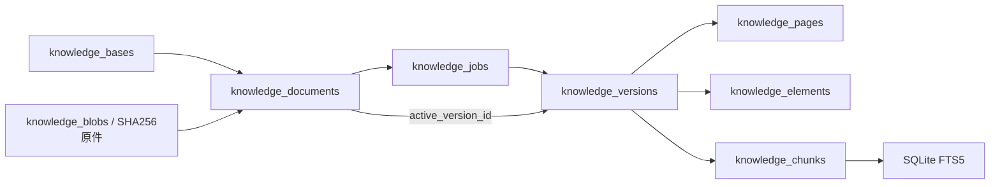

# 知识库数据库与入库首批验收

日期：2026-11-12。实现依据是[数据库与入库设计](../superpowers/specs/2026-11-12-knowledge-ingestion-design.md)，GitHub案例核查见[研究记录](../research/2026-11-12-knowledge-github-cases.md)。

## 已实现的闭环

新建知识库 → 原始bytes上传 → SHA256去重 → 持久化入库任务 → 受控解析子进程 → 校验page/element/chunk与坐标 → FTS5事务索引与active version切换 → 词法检索/切片读取/原文页链接。支持文献停用和幂等重解析，失败保留原可用版本。

采用现有SQLite，不新增必须单独运维的数据库服务器。原件按内容寻址保存在本机，元数据和提取结果在数据库；未向云模型发送论文。

## 数据库怎样建立

`0006_knowledge.py`是Alembic迁移，接续0005。运营者使用已配置的`database_path`执行`great-agent migrate --config ...`，程序验证历史schema、备份并升级；不是手工创建一个空.db或拼贴零散DDL。

| 表 | 作用 |
|---|---|
| knowledge_bases | 逻辑库及检索范围 |
| knowledge_blobs | SHA256唯一的原件身份、大小、类型及受控相对路径 |
| knowledge_documents | 库与原件的关联、展示名、启停与当前可用版本 |
| knowledge_jobs | 持久化队列、owner、状态、失败原因与幂等request_id |
| knowledge_versions | 不可变解析版本、parser/config指纹、元信息与warnings |
| knowledge_pages | 物理页索引、页标签、尺寸、角色与原始页文字 |
| knowledge_elements | 章节/段落/表格/公式/图片等元素及来源位置/质量/结构 |
| knowledge_chunks | 检索切片、所属版本、来源元素、位置与质量标记 |

FTS5外部内容虚表`knowledge_chunks_fts`及三个触发器与chunk同事务更新。查询再次关联document.enabled和active_version_id，不能单凭FTS命中返回已停用/旧版本内容。显式历史chunk读取保留原ID与版本，便于以后绑定引用。

正常配置的正式路径是`F:\GREAT_Agent\data\great_agent.db`和`F:\GREAT_Agent\data\knowledge\`；本次**没有迁移正式DB或重启原API/Worker**。

## 用户论文的真实API回放

本轮实际生成的数据库：

`F:\GREAT_Agent\output\knowledge\tao-2025-product-acceptance\a528f6c4\state.db`

原件与内容寻址存储：同目录`knowledge\blobs\`。可机器读取证据见`output/knowledge/tao-2025-product-acceptance/api-latest.json`；完整结果也保存于上述目录`api-acceptance.json`。

测试来源为用户指定Zotero论文，SHA256为`23dbbbcb5681afb6e00508578a16785f1679a01e27c07d39838569eb9aa76702`。通过实际产品路由上传，而不是直接往chunk表写人工切片：

- 上传返回202；同内容改名重传复用同文档与任务，返回完整warnings。
- 原件HTTP返回字节与输入hash相同。
- 通用解析器保留16物理页，生成91切片；第16页为publisher_terms，保留页文字/尺寸，但未进入科研元素与切片。
- “钟差”“phase OSB”“convergence”“nominal validity”均返回词法结果。中文使用静态GNSS词典扩展，不等同于中文语义检索。
- Docling未配置本地模型时明确失败：`Docling requires an explicit local artifacts directory; model downloads are disabled`。失败后原active_version_id仍可检索。
- 停用立即返回空检索结果，原文读取404；重新启用后原版本仍在。
- 完成与失败后staging无遗留文件。

服务退出后另以只读SQLite重开验证：数据库892,928字节、revision=`0006`、`PRAGMA integrity_check=ok`、16页/91片，FTS中`clock`有22片命中。证明资料已落盘，而非仅在测试进程内存中。

这组数据特意包含一次未准备本地模型的失败重解析，以验证保留旧版；因此最近job可显示失败，文档仍有可用active版本。这不是整个文档已无法使用。

## 切片与解析范围

默认本地pdfplumber自动基线不使用先前Tao手工profile。章节/双栏阅读顺序采用启发式；原始页文本、位置与质量标记均保存。目标切片700估算token，短完整段落重叠上限100；模型tokenizer尚未冻结。

公式上下标/矩阵、表格结构/单位、图片内数字**未完成科学语义验收**，PDF均带质量提示；不把非空文字当高质量解析成功。Docling适配器保留原生JSON与provenance/table结构，并限制只用显式本地artifacts；本批只验证JSON fixture和失败边界，未安装或运行其实模型。

本批提供原文物理页链接并保存bbox，尚无PDF矩形高亮。向量检索、rerank、聊天`search_knowledge/read_evidence`与答案引用验证仍未接入，Agent的论文分析能力标志保持未就绪。

## 复核与验证

- Repository最终44项定向通过：去重/跨库/旧版/owner CAS/原子回滚/静态词典/FTS注入字符及虚表、shadow保留名冲突。
- Parser最终40项通过、1项跳过：Windows缺创建symlink权限；路径边界的其余测试仍通过。包含真实小PDF、原生Docling JSON与通用末页条款反例。
- API/迁移/schema review24项通过；旧接口与知识API相关86项通过。
- 前端最终完整190项测试通过，97.31秒、exit0；隔离构建、类型检查及lint通过。独立UI审核发现建库初始化竞态，已补回归修复。
- 独立后端审核发现并修复：未知DB运行时误采用、claim失败吞取消、启动取消后遗留recovery线程、锁绑定错误存储目录、解析staging累积。补测试观察RED→GREEN后复审通过，并另实测子进程取消/越界清理。

整套后端最新结果为**573通过、1跳过、2失败**（234.96秒），未达到全量绿色。失败为`test_recovery_native.py::test_native_orphan_is_observed_then_released_without_reexecution[False]`和`[True]`：前者原生terminate后等待5秒超时，后者停止复核后仍为running。前一全量轮次另曾出现`test_worker.py::test_cancel_from_separate_api_worker_reaches_real_worker`的2秒超时；最新轮次该项通过。

针对性调查未改实现或放宽deadline：native与跨API取消三项单独3通过/2.01秒；knowledge_*之后同进程接native为105通过、1跳过/10.53秒；另外一组logging/mock/monitor/plan/position/proposal之后接native为98通过/14.61秒；20个自建sleeper的原生终止无失败。尚未确认全量失败根因，不能用这些定向通过代替整套通过，也不能凭现场CPU/内存状况推断根因。

浏览器完整闭环**未完成**，13项均未执行到通过：三次CDP在首个`Page.enable`超时。后续最小探针确认Browser.getVersion曾收到响应，但Chrome157的GPU子进程反复以`0xC0000022 ACCESS_DENIED`退出，随后`GPU process isn't usable. Goodbye.`关闭浏览器，页面连接1006。沙箱外对照执行被取消，不能据此断言问题只由沙箱引起。

诊断证据在`tmp/knowledge-browser-results/cdp-diagnostic.json`，原失败在同目录`result.json`；本轮owned Chrome/Node/fixture均已结束。不能把真实API入库证明或190个前端组件测试写成浏览器整体验收通过。本批未取得浏览器截图。

## 前端构建误写及恢复

一次子任务构建在22:00:50误写了`frontend/dist`。已从11/12两份Chrome验收缓存恢复最近可核验的Chat构建，原子切回`index-DKADVSva.js`，CSS与缓存hash相同；保留新BY4资产以避免已打开页资源缺失。HTTP8765入口和两份JS/CSS均200且hash匹配，未重启服务。证据在`.codex_work/knowledge-ingestion-20261112/recovery/`。

这恢复了最近可核验的已验收构建，不能证明它恰好等于22:00误写前一刻的入口。此后构建仅写`tmp/knowledge-ingestion-dist`；本批知识入口未切换进正式服务。

收尾进程核对：原Python PID26496/29484及10:16启动时间保持；入口HTML的SHA256仍为恢复记录的CE7CD447347DD54CF97DDC62678BBD1823F0D7BEBAB745D9774283CACB57596B。当前执行环境对8765的HTTP健康请求经默认代理得到502，禁用代理后连接被拒绝；未将当前正式服务健康状态认定为通过，也未为此重启或改变其配置。
